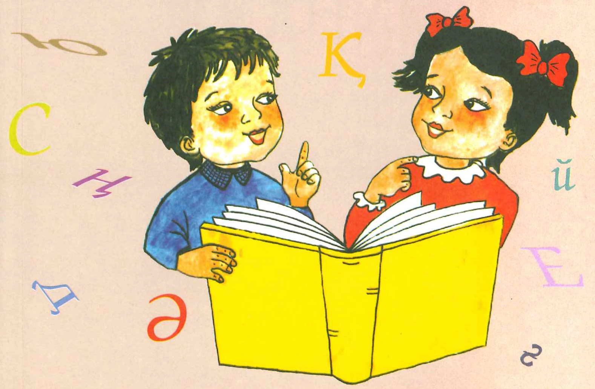
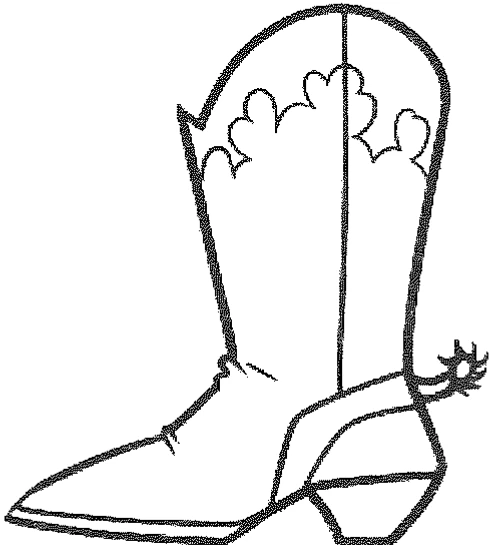

# 阅读技能训练册2023（4）_Өлке

## PDF 第 1 页

ОҚУТЕХНИКАСЬ

Бастауыш сынып оқушыларының оқу техникасын
тексеруге арналған жұмыс дәптері

OҚ
ТЕХНИКАСЫ

Бастауыш сынып окушыларының оку техникасын
тексеруге арналған жұмыс дэптері

4-сынып

A
4
bl
m
H
Ц
C
БАСПАСЫ
ISBN 978-601-253-114-5
786012531145
2
K
X
O

## PDF 第 2 页

Э. Б. Сулейманова, Ш. Г. Оспанбекова

### ТЕХНИКАСЫ

4-СbHbП

4
enke
АСПАСЫ
e

## PDF 第 3 页

УДК 373.3.016
66K 74.202.4
H 52

### Пікір жазғандар: Г. Жүнісова – педогогика ғылымдарының кандидаты
Г. Сүйіндікова – казақ тілі мен әдебиет пәнінің мұғалімі

Кеңесші: К. Ерешева — өдіскер-мұгалім

Сулейманова Э. Б., Оспанбекова Ш. Г.
H 52
Оку техникасы. 4-сынып / Э. Б. Сулейманова, Ш. Г. Оспанбекова. —
Алматы: «Өлке» баспасы, 2023. — 96 бет.

ISBN 978-601-253-114-5

Сіздің колыңыздағы бұл кітапша - балалардың мәтінді дұрыс, түсініп,
мәнерлеп және белгілі қарқынмен оқуына септігін тигізеді деген ойдамыз.

Бастауыш сыныптарда оку техникасына қойылатын негізгі талаптар сак-
талған кезде оқушылар мәтіннің мазмұнын түсінеді. Өйткені дұрыс, түсініп,
мәнерлеп және белгілі бір қарқынмен оқу өзара тығыз байланысты. Балалар
дұрыс оқуға дағдылану арқылы мәтіндегі ойды дәл түсіне алатын болады.

Бұл көмекші құралда оқушылардың оку техникасын тексеруге арналған
тапсырмалар, тест сұрақтары мен бағалау нормасын анықтайтын шарттар
берілген.

УДК 373.3.016
56K 74.202.4

ISBN 978-601-253-114-5

© «Өлке», 2023

### АлғЫ сөз

Бастауыш сыныптарда окушымен оқыту технологиялары арқылы
жаттықтыру жұмыстары жүргізіледі. Мөтін дауыстап және іштей
оқылады. Оқудың бұл екі түрінде де оқу техникасының талаптары
қойылады. Бұл талаптар бір-бірімен тығыз байланысты. Өйткені тү-
сінбей, мәнерлеп оқи алмайды, ал дұрыс оқымаса, түсінбейді.

Муғалім тарапынан оку техникасын тексеруге дайындалу барысын-
да нақты тапсырмалар беріледі.

Мәселен, мәнерлеп оқуға жаттық, тыныс белгілерін анықта, дауыс
ырғағын айқындап ал, бірнеше рет (екі рет) оқып көр, әр сөздің ма-
ғынасын түсін деген талаптар қойылып отыруын қолдаймыз. Яғни,
оку техникасын тексерер алдында оқушының қабілетіне қарай
мәтінді тандап беру жөне оның дайындалуына уақыт (5-10 мин)
бөлінуі қажет.

Дұрыс окудың негізі сауат ашу кезінде-ақ басталады. Осы кезде
әрбір сөзді буындап оқуға жаттықтырған жөн. Оқығанда қиын тиген
сөздерге талдау жасап отырудың дұрыс оқуға дағдылану үшін пай-
дасы зор.

Тусініп оку - оқушының оқыған мәтіннің мазмұнын анық, терең
ұғынуы болып табылады. Оқығанын толық түсінуін балалардың мәтін-
дегі. негізгі ойды айыра алуларынан, оның мазмұнына өзінің көзқара-
сын білдіруінен байқауға болады.

Шапшаң оқу — мәтіндегі сөздерді қалай болса солай, сөздердің ара-
жігін айырмай тез оку емес. Мәтінді баяу оқыған бала мәтіннің мазмұ-
нын түсінбек түгіл, бір сөйлемнің өзінде не айтылғанын аңғармай қалуы
мүмкін. Сондықтан, мәтіннің мазмұнын түсінетіндей жылдамдықпен
оқу маңызды. Шапшаң оқу барысында әр баланың оқу қарқыны әр-
түрлі, сондықтан бір минутта оқылатын сөздердің саны да азды-көпті
болуы мүмкін.

Мәнерлеп оқу — сөйлеу сазы (интонациясы) арқылы автордың ойын
білдіру, мазмұндық ой екпінін дұрыс қоя білу, кейіпкердің көңіл күйін
сезіне оқи білу.

Мәнерлеп оқу кезінде әр сөздегі ойдың ара жігін ескере отырып,
дауысты құбылтып, тиісті жағдайда сөздерге рең беріп оқылады.

Мәнерлеп окуда басты үш міндет орындалады:

- оқушылар шығарманың мазмұнын түсінеді;

-шығармадағы кейіпкерлер қайта жасалады;

- шығармадағы қөңіл-күй көрсетіледі.

3-

"

## PDF 第 4 页

Қазақ тілін бастауыш сыныпта оқытудың эдіскері, ғалым Сағира
Рахметованың 4-сынып окушыларының мэтінді дауыстап окуына
отырмыз.

Оку техникасы: Дауыс кідірісін, ырғағын дурыс сактап оку, эмоция-
лық бояуларды байқау. Мәнерлеп, белгілі бір қарқынмен шапшаң оку.

Біліктерге қойылатын талаптар: I жартыжылдықта дұрыс, түсініп,
мәнерлеп, минутына 80-90 сөз, ал II жартыжылдықта минутына 100-
120 сөз оку. Мумкіндік деңгейі — 110 сөз оку. Эмоциялық бояуларды
байқап кейіпкердің көңіл күйін сезініп, дауыс кідірісін, ырғағын дұрыс
қою арқылы құбылтып оку. Мәтін мазмұнына сэйкес өзіндік пікірін
білдіре оку.

Мәнерлеп оқуға өз беттерімен дайындалу. Мәтіндерді бөлімдерге
бөлу. Әр бөлімдегі негізгі ойды табу. Мәтіннің жоспарын жасау.

Оку барысында оқушының білігі мен дағдысын былайша бағалауды
әр мәтіннің соңына берілді. Мұғалім окушының оку техникасын осы
талаптарға сай бағалауына болады.

Осы оку құралына әртүрлі тақырыптағы мәтіндер беріліп отыр.
Олардың кейбірінің мазмуны күрделі құрылған. Ол окуға өбден жат-
тыққан, сөздік қоры мол оқушыларға арналған. Сөз саны көбірек бе-
рілген мәтіндерді оқушының бір минутта оқып шығуы міндетті емес.
Сондықтан мәтіндерді оқушыға оңайынан бастап, күрделісіне ауысып
отыруын ұсынамыз.

Окушылардың оку техникасын тексеру — сабактан тыс жұмыс. Ол
өздігінен орындалатын сабақтың түрі болып есептеледі. Оқу техника-
сын тексеруге арнайы сағат бөлінбеген. Дегенмен, оқушылардың оқу
техникасы тексерусіз қалдырылмайды. Сол себептен, тексеру жолы
мұғалімнің өз еркіне беріледі.

Оқу техникасын тексеру барысында, муғалім тарапынан оқу-
шыға қысым жасау, оларды жеку, кемшілігін басып айту сияқты
жағымсыз әрекеттер болмауы тиіс. Баланың жас ерекшеліктері
мен денсаулығына, психикасына зияны тимесе, ой-өрісіне қатты
күш салынбаса муғалімнің шығармашылық ізденісіне мін тағыл-
майды.

Сағира Рахметова «Қазақ тілін оқыту әдістемесі» атты еңбегінде
оқу дағдысын қалыптастырудың әдіс-тәсілдеріне жан-жақты тоқта-
лып, кеңінен сипаттама берген. «Оқу техникасы» жұмыс дәптерін қол-
дану барысында, ғалымның еңбегін күнделікті тәжірибеде пайдалана
отырып, жақсы нәтижелерге жетулеріңізге тілектеспіз.

### Әже

Өженің жайлы арқасы
Секілді мамық құстөсек.
Жабысып,
Қолдар айқасып,
Ертеден кешке түспес ек.

Шешеге бір сөт ұнамай,
Түнере қалса бұлт келіп,
Әженің бауыры —
ұядай,
Кетуші ек соған зып беріп.

Сәні еді
Ауыл-үйдің де,
Жүруші ек оны пір тұтып.
Жеткізген бізді бұл күнге
Жабағы жүлып,
Жүн түтіп.

Текемет басып,
Тері илеп,
Көрпеше құрап қиықтан,
Өжелер
бізді жер үйде
Саусағымен-ақ жылыткан.

Тағдыр да
Берген пейілді,
Қолына қонған береке.

—4

-5

V
.

## PDF 第 5 页

Ол жүрген жерде —
Көңілді,
Ол жүрген жерде —
Мереке.

Әжесіз күй жоқ, асылы,
Өжесіз үйдің —
аз әні.
Аруана тектес асылым,
Ак әжем —
Елдің ажары.

Ак эжем—
Аскар тауымдай.
Шуданы тастап шумақтап,
Жататын оның жанында
Боз ала бұлттар будақтап.

Болмайтын қаяу,
Кіршік те,
Жатушы ем мен де жайланып,
Үйірген әжем ұршықпен
Дүние қоса айналып.

Сағи Жиенбаевтан

### Сұрақтарға жауап бер.

1. Ақын әже мейірімін қандай теңеулермен жеткізген? Сол
мәнерлі жолдарды тауып, көшіріп жаз.

2. Өжесіне арналған ақын махаббатын, сағынышын өлең
жолдарынан тауып, қайталап ерекше әсермен мөнерлеп
Оқb.

3. Жататын оның жанында
Боз ала бұлттар будақтап, — дегенді қалай түсінесің?

Барлық сөз саны: 119
Оқуға кеткен уақыт:
Минутына оқылған сөз саны:
Оку барысында оқушының білігі мен дағдысын бағалау.
- баяу, дұрыс, түсініп, мәнерсіздеу оқиды
шапшаң, мәнерсіз, сөзді бұрмалап, түсінбей оқиды
- өте баяу, бірқалыпты, дұрыс, тусініп, мәнерсіз оқиды
- орташа қарқынмен, дұрыс, түсініп, мәнерлеп оқиды
- шапшаң, дұрыс, түсініп, мәнерлеп оқиды
Бағасы:
Мұғалімнің қолы:

6 

-7 -

## PDF 第 6 页

### Туган жер

Жұпар атқан кең жазықтың төсінде жұмсақ қара жолмен
жүрдек машина барынша зырлап келе жатқанда, ұшқыр қиял
шіркін де туғырында тоқырап кала алмайды-ау. Канатын
қағып, қағып жіберіп, дауылпаздай шарқ ұрып, ол да самғап
ұшады.

О, атамекенім, қазақ жері! Сенің шет-шегіңе қиялдан өзге
не жетіп үлгереді? Сол алып өлкеңнің бір пушпағын ыстық
көзбен, бар адал сезіміммен аймалап, елеусіз бір перзентің
мен келе жатырмын.

Мынау асқар тау, жасыл жазық, мөлдір өзен, қалықтаған
анау ақша бұлттар, тұнық аспан — осының бәр-бәрін егер
кұшағым жетсе, ең қымбат, аяулы анамдай аймалап қушар
едім, сүйер едім. Япыр-ай, неге сонша ыстық болдың туған
xep!

Мен табиғатты сүйемін. Мен шынайы поэзияны сүйемін.
Абай мен Қасымды қанша оқысам да менің сусыным қан-
байды. Қайталап оқи бергім келеді, оқи бергім келеді.

Мен Құрманғазы мен Дәулеткерейдің күйлерін тындаған-
да өзімді-өзім ұмытып кетемін. Махамбет жырының әр сөзі-
нің астынан дүрсілдеген ат дүбірін, қарыш-кұрыш сілтескен
найза, қылыш үндерін естігендей болам.

О, қасиетіңнен айналайын, қазақ жері! Осының бәрі сенің
топырағыңда өсіп, өнген кереметтер емес пе!

Бердібек Соқпақбаевтан
«Менің атым Қожа» повесінен үзінді

Сурақтарға жауап бер.

1. Автор шалқыған көңіл күйін жеткізуге қолданған теңеу-
лерін мәтіннен тауып, көшіріп жаз.

2. Мөтіндегі кара сөзбен жазылған сөздердің мағынасы
қандай? Ол сөз тіркестерін мағынасын өзгертпей, басқа сөз-
бен ауыстырып көр. Қайсысы өсерлі шықты?

_________

3. Туған жерінді сен қалай жақсы көресің?

4. Сүйіп тындайтын күй, өлең, жырың бар ма?

Барлық сөз саны: 158
Окуға кеткен уақыт:
Минутына оқылған сөз саны:

Оқу барысында окушының білігі мен дағдысын бағалау.
-баяу, дұрыс, түсініп, мәнерсіздеу оқиды
- шапшаң, мәнерсіз, сөзді бұрмалап, түсінбей оқиды
- өте баяу, бірқалыпты, дұрыс, түсініп, мәнерсіз оқиды
- орташа қарқынмен, дұрыс, түсініп, мәнерлеп оқиды
- шапшаң, дұрыс, түсініп, мәнерлеп оқиды

Багасы:
Мұғалімнің қолы:

OT-4-сынып-2

-8 -

9-

## PDF 第 7 页

### Мен жастарға сенемін

Арыстандай айбатты,
Жолбарыстай қайратты -
Қырандай күшті қанатты,
Мен жастарға сенемін!

Көздерінде от ойнар,
Сөздерінде жалын бар,
Жаннан қымбат оларға ар,
Мен жастарға сенемін!

Жас қырандар - балапан,
Жайып қанат ұмтылған.
Көздегені көк аспан.
Мен жастарға сенемін!

Жумсақ мінез жібектер,
Сүттей таза жүректер.
Қасиетті тілектер —
Мен жастарға сенемін!

Тау суындай гүрілдер,
Айбынды алаш елім дер,
Алтын Арка жерім дер,
Мен жастарға сенемін!

Қажу бар ма тұлпарға,
Талу бар ма сұңқарға,
Иман күшті оларда,
Мен жастарға сенемін!.

Алаш айбынды ұраны,
Қасиетті қкұраны,
Алаштың олар кұрбаны,
Мен жастарға сенемін!

Мен сенемін жастарға,
Алаш атын аспанға
Шығарар олар бір танда,
Мен жастарға сенемін!

Мағжан Жумабаевтан

### Сұрақтарға жауап бер.

1. Мағжан Жумабаев туралы не білесін? Есіңе тусір. Ізде-
ніп, Мағжанның өмірбаянымен таныс. Қыскаша мазмұнда.

2. Мағжан ақын сенім арткан жастар сенің жанында бар
ма? Өленде сипатталған мінез бен қасиетті үйде немесе
баска жерде кімнің бойынан көресің? Пікірінді жаз.

________

Барлык сөз саны: 101
Оқуға кеткен уақыт:
Минутына оқылған сөз саны:
Оку барысында окушының білігі мен дағдысын бағалау.
- баяу, дұрыс, түсініп, мәнерсіздеу оқиды
- шапшаң, мәнерсіз, сөзді бұрмалап, түсінбей оқиды
- өте баяу, бірқалыпты, дұрыс, түсініп, мәнерсіз оқиды
- орташа қарқынмен, дұрыс, түсініп, мәнерлеп оқиды
- шапшаң, дұрыс, түсініп, мәнерлеп оқиды
Бағасы:
Муғалімнің қолы:

10

-11-

## PDF 第 8 页

### Кусканаты

Жазғытурымның май тоңғысыз күні. Қалбалактаган көп
қылау мұның да омырауын қармай алды. Көшедегі жұрт қар
көрмегендей аспанға алақандарын тосып мәз боп жатыр. Бір
кішкентай кара шунақ бала колына таяқ ұстаған ақ киме-
шекті әженің біресе о жағынан, біресе бұ жағынан шығыл,
мазалап келеді.

Өже деймін, көктем қашан шығады?

—Ертең шығады.

— Ертең шықса, бүгін неге қар жауады?

– Бұл «құсканаты» ғой, қарағым. Қыс ызғары осымен бірге
кетеді.

Есіне енді тусті. Бұл — қыстың соңы «құсқанаты».

Будан соң қар түспейді. Құйпалақтап қалың жауып түр.
Жаз биыл жайлы болатын түрі бар.

Ауылда ғой жұрт қазір ерсілі-қарсылы шапқылап жүр.
Бүгін бір-бірімен сары ала таңнан барып амандасады.
Кемпір біткен асадалдың түбіндегі өлі астың бәрін қа-
занға салады. Бүгіннен қалса — мәкіру.. Қара су құйсаң да,
қара қазан ошақта толып тұрады бүгін. Көрісуге келген жұрт
үй сайын аяқ-аяк наурыз көже ішеді. Бүгін қазаны толмаған
үйдің биылғы ырзығы кем болады.

Қазір үйіне жеткен соң бұл да төрт пілтелі газ пештің бә-
рін жағып, үйдегі куыстың бэрін толтырып отка қояды. Жа-
рықтық жаңа жаз, жаңа көктем бұлардың шаңырағына да
тек шапағат боп кіргей.

Әбіш Кекілбайұлынан
«Құсканаты» повесінен үзінді

Тапсырманы орында.

1. Мәтінде не туралы айтылады?

әже мен бала жайында
жауған қар туралы
көктем мезгілінің жеткені жайында

2. «Бул — қыстың соңы «кұсканаты» — деген сөйлемді
қалай түсінесің?

3. Автор кай мерекені айтып отыр? Бул кай күні бастала-
тын мереке? Және қалай аталады?

«Ауылда ғой жұрт қазір ерсілі-карсылы шапқылап жүр.
Бүгін бір-бірімен сары ала таңнан барып амандасады».

4. Қарамен жазылған сөйлемді өз сөзіңмен айтып бер.

Барлық сөз саны: 169
Окуға кеткен уақыт:

Минутына оқылған сөз саны:

Оқу барысында окушының білігі мен дағдысын бағалау.
- баяу, дұрыс, түсініп, мәнерсіздеу оқиды
- шапшаң, мәнерсіз, сөзді бұрмалап, түсінбей оқиды
- өте баяу, бірқалыпты, дұрыс, тусініп, мәнерсіз оқиды
- орташа қарқынмен, дұрыс, түсініп, мәнерлеп оқиды
- шапшаң, дұрыс, түсініп, мәнерлеп оқиды

Бағасы:
Муғалімнің қолы:

12

13-

## PDF 第 9 页

### Мен елімді сүйемін

Туған ел! Бул кішкентай үйіңнің табалдырығынан баста-
лады. Содан шетсіз, шексіз қияға өрлеп кете барады. Оның
жұпар атқан жусаны, оның кеудеңе құйылған мөлдір ауасы,
жотаға өрлеген жалғызаяқ жолдары - осының бәрі-бәрі се-
нің туған елінді кұрайды.

Туған жерсіз адамның күні жок. Алыс кетсең, өз үйіңнің
муржасына дейін сағынасың. Туған жерің түсіңе енеді.
Алыстан сені кол булғап шакырады.

Туған ел мағынасы теренде жатыр. Балғын балалық шақ!
Күлдір-күлдір кісінеп, айнала шапқылаған ала аяқты құлын-
шақ! Сэуірде бүршік аткан, қылтиып күн көзіне көрінген
балауса көк шөп. Өзен үстінде үйіріліп ұшқан шағала! Кеме-
ріне жайлап соққан көгілдір көл. Күннің қызғылт шапағына
бөленген үйлер — осының бөрі тұтас тұрған туған ел! Ал енді
ананың бесікте жатқанда айтқан әлдиі, әженің тамылжыта
төккен тамаша ертегілері, туғандарыңның мейірбанды күл-
кілері, жеңгелеріңнің тәтті әзілдері — осының бәрі туған
еліңнің керемет сипаттары! Туған елдің тілі барша жанга
түсінікті!

Сырбай Мәуленовтен

Сұрақтарға жауап бер.

1. Автор туган елдің мағынасын кандай сөздермен
жеткізген?

Осы сөздерден автордың туған еліне деген көзқарасы
қандай екенін қалай байқаймыз?

________

2. Автор жырақта жүргенде туған еліне сағынышын қалай
жеткізген?

Оқуға кеткен уақыт:
Барлық сөз саны: 133

Минутына оқылған сөз саны:

Оқу барысында окушының білігі мен дагдысын бағалау.
- баяу, дұрыс, түсініп, мәнерсіздеу оқиды
- шапшаң, мәнерсіз, сөзді бұрмалап, түсінбей оқиды
- өте баяу, бірқалыпты, дұрыс, түсініп, мәнерсіз оқиды
- орташа қарқынмен, дұрыс, түсініп, мәнерлеп оқиды
- шапшаң, дұрыс, түсініп, мәнерлеп оқиды

Муғалімнің қолы:
Бағасы:

-15-

-14

## PDF 第 10 页

### «Сымбатты сиыр жайлы хикая

Ерте заманда жануарлардың ішінде ең жүйрігі де, сым-
баттысы да сиыр болыпты. Сиырға ешбірі ілесе алмапты.
Келе-келе сиырға менмендік, өркөкіректік пайда болады.

Бірде ол жайылымда жүрген жылқыға кездесіп:

– Ей, ашқарак, менің сөзіме құлақ сал. Сен өмірі күйіс
қайтармайсың, жетер осы жайылғаның. Менімен жарыса-
сың ба? — дейді.

— Мейлі, жарыссак – жарысайык, — деп жылкы келісімін
береді.

Олар өздеріне межелі жерді белгілейді. Жолдың ортасын-
да көдімгі суыр жарысқандарға су беріп, дем беріп отырды.
Ә дегенде-ақ сиыр құйрығын шаншып алып, жылқыдан озып
кетеді. Орта жолда ол:

-Суыр пасык, су кайда? — дейді көкіректеніп.

—Сиыр пасық, су мунда! — деп ызасы келген суыр сиырға
боржып турып калған суды ұсынады. Сиыр карамастан сімі-
ріп салады да, тасырлатып әрі шауып кетеді.

Сиыр бір қыр асқан соң жылқы ентігіп жетіп суырға:

-Суыр сұңкар, су кайда? - дейді.

—Жылкы тұлпар, су мунда! — деп суыр риза болып жыл-
қыға салқын, таза суды ұсынады.

Салкын су бойын ширатқан жылкы сиырдан озып межеге
бұрын жетеді.

Міне, содан бері жылқы баласы сулу да сымбатты, жүйрік
болыпты. Ал сиыр сол оқиғадан соң демігіп жүгіре алмай,
шабан жүрісті болып қалған деседі.

Тапсырманы орында.

1. Мэтіннің кай түрін оқыдың?
әңгіме
eртеri
хикая

2. Ертегіші сиырдан қандай кейіпкер жасаған?

3. Ертегіден қандай ой түйдің?

Барлық сөз саны: 171
Оқуға кеткен уақыт:
Минутына оқылған сөз саны:

Оку барысында окушының білігі мен дағдысын бағалау.
- баяу, дұрыс, түсініп, мәнерсіздеу оқиды
- шапшаң, мәнерсіз, сөзді бұрмалап, түсінбей оқиды
- өте баяу, бірқалыпты, дұрыс, түсініп, мәнерсіз оқиды
- орташа қарқынмен, дұрыс, түсініп, мәнерлеп оқиды
-шапшаң, дұрыс, түсініп, мәнерлеп оқиды

Бағасы:
Муғалімнің колы:

от-4-сынып-3

-16-

-17

ч

## PDF 第 11 页

### Боран

... Суық қатайғаннан болса керек, аспаннан түскен қар ал-
ғашқыдай ұсақ емес, жабыскақ үгінді қар емес, жүмырланған
ұсак, катты, қиыршық болып жиілеп ұра бастады. Мандайды
желге қарсы беріп жүру, өсіресе қиындады. Азғана уақыт
ішінде аттың кұлағына шейін, Абайдың селдір сақал-мұрты
мен кірпігіне шейін қырау басып қалды.

Абайдың түлкі тымағының екі самайынан қадалып ұрған
жел шекесін шаныштыра бастады. Еңкейіп келе жатып, бетін
бурып, ықтап шабайын десе, желкелігінен ұрып, мойнына
қарды тықпалай береді. Кайта бурылғанда аязды боран
бетін, мұрнын жалап, ығын кетіре бастады. Енді колыменен
бетин жии-жиі укалап, усинуден сақтанды. Кос колы қатты
тоңып, саусақтарының ұштары шаншып, тізгін мен камшы
ұстауға ебін кетірді. Карып, муздатып барады. Сол күйдің
үстіне, эсіресе екі самайынан тымақ ішін кеулей ұрған жел
шыдатарлық емес.

Ығы кетіп, ер үстінде аз жүрісте оңға да, солға да бұрыл-
ды. Еңкейіп, ат жалына да бугіле түсіп шапқан Абайдың
мазасы кетті. Құр мазасыздық емес, енді беті-қолдың үсіну
қаупі бар. Самайдан өткен жел одан да катер. Тоңу ығын
кетіре күшейген сайын, енді Абай етегіне де ие бола алма-
ды. Қайта-қайта қымтаған етегін сәл қозғалса, жел ақтарма-
лап жұлып ашып, қайырып жібереді. Басында өзге жолдас-
тарынан бұрын суыққа сыр бермеспін десе де, енді шыдап
болмады.

... Қанша екені белгісіз, ұзақ бір шыдамға тістеніп бекініп
алғандай болған жолаушылар көп заман толассыз, тыным-
сыз қатты жүрістен аумай келеді. Көптен кұлақка беймаза
боп ысқыра шулап соққан жел кейде ерекше бір ызамен

ышқынып кетіп, екпіндетеді. Күні бойы үзілместен шу-шу
еткен жалғыз үн кұлақ тұндырғандай. Сарылған суық сазы-
нан жаңылған жок. Кейде ақ боран, қатты аяз ұлып та кетеді.
Көп бөрінің боранды далада, құтырған дауыл ішінде баспа-
на іздеп, жас қан іздеп, қосылып ұлығанындай азан салады.

Мүхтар Әуезовтен

Сурақтарга жауап бер.

1. Өңгімеде жылдың қай мезгілі сипатталған? Жазушының
табиғат кұбылысын сипаттаған тұсын қайта-қайта оқып, өз
бетіңше жазып көр.

2. Мәтіндегі кейіпкер кім? Ол адамның боранға тап болған
жай-күйін көз алдыңа елестетіп көр және сипаттап жаз.

3. Мәтіннің үшінші азат жолын қайталап оқы. Осы бөлікті
қалай атар едің?

4. Әңгімеге сүйеніп, үсінуден қалай сақтануға болатынын
жаз.

18 -

-19

«

## PDF 第 12 页

5. Жазушы Мухтар Әуезов туралы не білесің? Оның ең
үлкен шығармасы кімге арналған және қалай аталады?
6. Абай Құнанбайұлы қай жылдарда өмір сүрді? Ол артына
кандай мура қалдырды?

Барлық сөз саны: 259
Оқуға кеткен уақыт:

Минутына оқылған сөз саны:

Оқу барысында оқушының білігі мен дағдысын бағалау.
- баяу, дұрыс, түсініп, мәнерсіздеу оқиды
- шапшаң, мәнерсіз, сөзді бұрмалап, түсінбей оқиды
- өте баяу, бірқалыпты, дұрыс, түсініп, мәнерсіз оқиды
- орташа қарқынмен, дұрыс, түсініп, мәнерлеп оқиды
- шапшаң, дұрыс, түсініп, мәнерлеп оқиды

Мұғалімнің қолы:
Багасы:.

### Қbс

Ак киімді, денелі, ақ сақалды.
Соқыр, мылкау, танымас тірі жанды.
Усти-басы ақ қырау, түсі суык,
Баскан жері сықырлап, келіп қалды.
Дем алысы — үскірік, аяз бен қар
Кәрі қудаң — қыс келіп, әлек салды.
Үшпадай1 бөркін киген оқшырайтып,
Аязбенен қызарып ажарланды.
Бұлттай қасы жауып екі көзін,
Басын сіліксе, қар жауып, мазанды алды.
Борандай бұрқ-сарқ етіп долданғанда
Алты қанат ақ орда үй шайқалды.
Өуес көріп жүгірген жас балалар
Беті-колы домбығып, үсік шалды.
Шидем мен тон кабаттап киген малшы
Бет қарауға шыдамай теріс айналды.
Қар тепкенге қажымас кайран жылкы
Титығы кұруына аз-ак қалды.
Қыспен бірге тумсығын салды қаскыр.
Малшыларым, кор қылма итке малды.
Соныға малды жайып, күзетіндер,
Үйқы өлтірмес, қайрат қыл, бұз қамалды!
Ит жегенше Қондыбай, Қанай² жесін,
Құр жібер мына антұрған кәрі шалды.

1888 жыл

Абай Құнанбайұлынан

1 Ушпа — шоқ-шок болып жөңкіген бұлт.
2 Қондыбай, Қанай — ру аттарымен аталатын, жерінің шөбін жылқыға жалдайтұғын ауылдар.

20 

-21 -

е

## PDF 第 13 页

Сұрақтарға жауап бер.

1. Кыс мезгілін акын кіммен салыстырады?

2. Ақын қыстың ызғарлы, суыктығын сездіру үшін қандай
теңеулер ойлап тапқан? Қай сөздерге екпін берген?

3. Өленді жаттап ал.

Барлық сөз саны: 136
Оқуға кеткен уақыт:
Минутына оқылған сөз саны:
Оку барысында окушының білігі мен дағдысын бағалау.
- баяу, дұрыс, түсініп, мәнерсіздеу оқиды
- шапшаң, мәнерсіз, сөзді бұрмалап, түсінбей оқиды
- өте баяу, біркалыпты, дұрыс, түсініп, мәнерсіз окиды
- орташа қарқынмен, дұрыс, түсініп, мәнерлеп оқиды
- шапшаң, дұрыс, түсініп, мәнерлеп оқиды
Муғалімнің қолы:
Багасы:

### Жыл кайыру

Ділдә әжей кешкілік немерелері Ілияс пен Өселдің кө-
кейлеріндегі әртүрлі сұрақтарға жауап береді.

-Әже, жыл кайыру дегеніміз не? Оны оңай жаттап алу-
дың қандай эдісі бар? - деген балалардың сұрақтарына
Ділдә әжей былай деп жауап берді.

— Көнекөз қариялардан естіген, ғасырлардан бермен келе
жаткан ең оңай қазақы жыл қайыру әдісін айтып берейін.

Түйе сеніп бойына,
Қалған ұмыт жылдардан.
Жатпа карап, мойыма,
Тайма именіп ділмардан.

Бар-жоғы осы. Жаттап алсандар, алты адал, алты арам-
нан тұратын және бір адал, бір арам болып кезектесіп келе-
тін жануар мен макулықтың рет санын жаңылмай табасың.
Ол үшін әр сөздің бастапқы әрпіне назар аудару керек.

Мәселен:

Түйе - тышкан
Сеніп — сиыр
Бойына - барыс
Қалған — коян
Үмыт - ұлу
Жылдардан -жылкы
Жатпа-жылан
Карап - кой
Мойыма — мешін
Тайма - тауық
Именіп — ит
Ділмардан — доңыз.

22 -

23-

4

## PDF 第 14 页

Осы он екі жыл адамның бір мүшел жасы болып есептел-
ген. Бір шумақ өлеңнің бойына ғүмырыңды сыйғызған халық
даналығы деген осы.

«Үрпағым, саған айтам...» кітабынан

### Сұрақтарға жауап бер.

1. Алты адал, алты арамнан тұратын және бір адал, бір
арам болып кезектесіп келетін жануар мен мақұлықтың рет
санын халық қайда пайдаланған? Жұмбақты шешіп көр.

2. Адамның бір мүшел жасы нешеге тең? Қай жаста адам
мүшелге толады?

Барлық сөз саны: 140
Окуга кеткен уақыт:

Минутына оқылған сөз саны:

Оку барысында окушының білігі мен дағдысын бағалау.
- баяу, дұрыс, түсініп, мәнерсіздеу оқиды
- шапшаң, мәнерсіз, сөзді бұрмалап, түсінбей оқиды
- өте баяу, біркалыпты, дұрыс, тусініп, мөнерсіз оқиды
- орташа қарқынмен, дұрыс, түсініп, мәнерлеп оқиды
- шапшаң, дұрыс, түсініп, мәнерлеп оқиды

Багасы:.
Муғалімнің қолы:

### Aқку

Ақку — өте ірі жөне күшті құстардың бірі. Ол сонау көне
заманнан бері сұлулық пен махаббаттың, тазалық пен нә-
зіктіктің белгісі болып саналады. Ақкуды көп халықтар киелі
құс санап ерекше құрметтеген.

Ақку әнші құстардың қатарына жатпайды.

Біздің хайунаттар бағынад ақкулардың екі түрі бар. Сы-
бырлақ аққу және сұңқылдақ аққу. Әлдене өсер ете қалса,
өзіне тән ызылдаған дауыс шығаратындықтан сыбырлақ аққу
осы атауға ие болған. Аққулардың ішіндегі ең әдемісі. Мой-
нын латынша «S» әрпі тәрізді етіп әсем ұстайды. Қанаттарын
сәл қомпайтқанда аппақ желкенге ұқсап, «тірі қайықтың» екі
бүйірінен керіле қалады.

Сыбырлактың тұмсығы қызыл, мандай алдында кара
түсті томпақ өсінді болады. Олар су өсімдіктері қалың өскен
жайылма суларда, көлдерде, кейде батпақтарда қоныста-
нады. Адам аяғы аз басатын, жағасында ну өскен су койма-
ларын мекен етеді.

Сұңқылдак ақку сыбырлақтан сэл кішірек. Мойнын тік
ұстайды, тұмсығы сары. Сыбырлақтан ерекшелігі — «Қыз
Жібек» фильмінде көрсетілгендей эдемі ашық дауысы бар.
Ең ірі құстардың бірі. Жыл құсы болып есептеледі. Тек кей
жерлерде ғана үя салған аудандарында қыстап калады.
Сұңқылдақтың ұя салып мекен етуге тандап алатын орны
қалың қамыс, басқа да су және жағалау өсімдіктері бар ірі
көлдер.

Сәуір айының көгілдір аспанында үлкен құстардың сұлу
мойнын соза тастап, канатын баяу сермеп бара жатуы -
естен кетпес ғажап сурет. Қалың орман ішіндегі көлде оңа-
ша жүзген аккуды көру - одан да сүлу кұбылыс. Ақку суда
дыбыс шығармай жеңіл жүзеді. Ал астындағы су жарқырап,

от-4-сынып-4

25 -

24

г

## PDF 第 15 页

маржанның түсіне енеді. Аккудың эрбір кимылы тамаша
таңғаларлық көрініс. Артына буйра толкын тастауы, жүзіп
бара жатып кілт бұрылуы, төсімен айдынды өбіп, қанатымен
күміс тамшы себелеп шомылуы, ауаны қақ жара көкке көте-
рілуі — бұл бір қайталанбас өсемдікті бейнелейтін қозғалыс.
Ақкулар — табиғаттың аса ғажап жөне сирек кездесетін туын-
дысы. Біздің елімізде оларды аулауға тыйым салынған.

Алматы зообағының қызметкері
A. Ракымова

Сурақтарға жауап бер.

1. Әлдене өсер ете қалса, өзіне тән ызылдаған дауыс
шығарады, — деп мәтінде қай құсты сипаттайды? Оның тағы
қандай белгісі бар?

2. Суңқылдақ ақкудың мекен ететін жерін сипаттап жаз.

Барлық сөз саны: 266
Окуга кеткен уақыт:
Минутына оқылған сөз саны:
Оқу барысында оқушының білігі мен дагдысын багалау.
- баяу, дұрыс, түсініп, мәнерсіздеу оқиды
- шапшаң, мәнерсіз, сөзді бұрмалап, түсінбей оқиды
- өте баяу, бірқалыпты, дұрыс, түсініп, мәнерсіз оқиды
- орташа қарқынмен, дұрыс, түсініп, мәнерлеп оқиды
- шапшаң, дұрыс, түсініп, мәнерлеп оқиды

Багасы:
Муғалімнің колы:

### Өлі суды ішуге болмайды

Қайнатылмаған суды өлі су дейді. Өлі су денсаулыққа
өте зиян.

Атакты саяхатшы Николай Михайлович Пржевальский
бірде аң аулауға шықты. Қайту сапарында қатты шөлдеді.
Ол өлі судың зиянды екенін білетін. Бірақ тандай кептірген
шөлге шыдамай, өзен суын ішті. Судан оған іш сүзегі жұқ-
ты. Саяхатшы көп ұзамай осы аурудан қаза тапты.

Өлі судың ішінде жай көзге көрінбейтін әртүрлі ұсақ
жөндіктер болады. Олар түрлі жұқпалы аурулар таратады.
Ӏш ауруы, сүзек, сары ауру өлі су ішкеннен жұғады.

Өзен, көлдердің суында мүндай зиянды жөндіктер көп.
Әсіресе ақпайтын су өте қауіпті. Су жай көзге таза, мөлдір
сияқты болып көрінеді. Бірак үлкейтілген шыны арқылы бір
тамшы суды алып қарасақ, онда қаптаған ұсақ жөндіктерді
көресің. Сондықтан өзен мен көлдің суын тек қайнатып ішу
керек. Қайнағанда судың ішіндегі зиянды жөндіктер өледі.

Өлі суды ішпеңдер!

Өзен мен көл сияқты кез келген су қоймаларын ластамай,
қадірлеп қарау әрбір азаматтың табиғат алдындағы боры-
шы. «Суға дәрет сындырма», «суға түкірме» деген қазақ хал-
қының тыйымын әрқашан есте сақтандар. Тамақтың қалды-
ғын, қоқыстарды тастамандар! Олар шіріп суды бүлдіреді.

### Сұрақтарға жауап бер.

1. Н.М. Пржевальскийдің өліміне не себеп болды?

-26

27 -

## PDF 第 16 页

2. Қандай суды өлі су дейді?
3. Өлі суды неге ішуге болмайды?
4. Суға катысты білетін ырымдар мен тыйымдарды жаз.

Барлық сөз саны: 165
Оқуға кеткен уақыт:

Минутына оқылған сөз саны:

Оку барысында окушының білігі мен дағдысын бағалау.
- баяу, дурыс, түсініп, мәнерсіздеу оқиды
- шапшаң, мәнерсіз, сөзді бұрмалап, түсінбей оқиды
- өте баяу, біркалыпты, дұрыс, түсініп, мәнерсіз оқиды
- орташа қарқынмен, дұрыс, түсініп, мәнерлеп оқиды
- шапшаң, дұрыс, түсініп, мәнерлеп оқиды

Муғалімнің қолы:
Багасы:

### Баланы өлімнен қүтқарған қус

Көлеңкеде қаннен-қаперсіз уйықтап жатқан жеті-сегіз
жасар балаға қарай тілін сумандатып улы жылан жақындап
келеді. Күтпеген жерден, қайдан шыға келгені белгісіз бір
құс бала мен жыланның арасына түсіп, кес-кестей береді.
Жылан да атылуға айналғандай шиыршықатып, айбат шегіп,
ысқырып жібереді. Құс аяғын санап басып, жақындай түсті.
Бала жайына қалды. Екі түз тағысының адам үшін шайқасы
басталып кетті. Жылан шабуылды үдете түсті. Бірақ кұс та
тез жалтарып, оның улы тісін бойына дарытатын емес. Міне,
жылан тағы да шап берді. Құс құйрығымен жер тіреп, жалта-
ра берді де, жылан басын қайтып тартып аламын дегенше,
өткір тұмсығымен оны төбесінен шоқып-шоқып алды. Жылан
жан саугалап, жиырыла кейін шегінеді. Бірақ ашулы кұс
шаңқылдап, үсті-үстіне шоқи берді, шоқи берді.

Бала оянып кетті. Ол қимылсыз бауыры жалтыраған улы
жыланды, оның қасында ауыр дем алып жатқан құсты көріп
таңғалды. Мұның екеуін бірдей кімнің өлтіріп кеткенін білмей,
аңырып жан-жағына қарады. Жүрегі әлсіз ғана соғып жатқан
мына кішкене құстың өзі үшін мерт болғанын бала түсінбеді.

Балаларға арналған күнтізбеден

Сұрақтарға жауап бер.
1. Өңгіме қалай өрбиді?

28

-29 -

## PDF 第 17 页

2. Өңгіменің шиеленіскен тұсы қай жерде?

Автор осы түсты эсерлендіру үшін кандай сөздерді
пайдаланған?

3. Қустың бейнесін сипатта.

Барлық сөз саны: 154
Окуға кеткен уақыт:

Минутына оқылган сөз саны:

Оқу барысында окушының білігі мен дағдысын бағалау.
- баяу, дұрыс, түсініп, мәнерсіздеу оқиды
- шапшаң, мәнерсіз, сөзді бұрмалап, түсінбей оқиды
- өте баяу, бірқалыпты, дұрыс, тусініп, мөнерсіз оқиды
- орташа қарқынмен, дұрыс, түсініп, мөнерлеп оқиды
- шапшаң, дұрыс, түсініп, мәнерлеп оқиды

Муғалімнің қолы:
Багасы:

### Саршунак пен шақшакай

Саршұнақ — кеміруші жәндік. Ол інін егіс маңына жақын
қазады. Көбіне астық дәндерімен қоректенеді. Кейбір құстар
саршұнақты аулайды. Соның бірі — қарақұс.

Саршұнақтың іні кұстардан сақтануға ыңғайлы. Ол інінен
алыска кетпейді. інінен шықса болды, жыртқыш құстар сап
ете қалады.

Міне, саршунақ інінің алдында мөлиіп отыр. Алыстап
жайылайын десе, жауынан қорқады. Ол өзінің осы аянышты
халіне катты налиды. Сыңсып жылап та кояды.

Қарақұстың келіп қалғанын байқаған шақшақай шырылдап
саршұнаққа белгі береді. Саршұнақ ініне сүңгіп кетті. Торғай
аспанда ұшып жүр. Енді өзі де жанын қоярға жер таппады.
Қысылғасын ай-шайға қарамастан, саршунақтың ініне кіріп
кетті. Қарақұс төңіректі біраз айналды. Інге бірнеше рет
шүйілді. Ештеңе ілікпеген соң көзден ғайып болды. Саршу-
нақ өзін ажалдан күтқарған досына тиген жоқ. Қонакжайлық
жасап, оны өзімен бірге тұруға шақырды. Міне, содан бері
олар ынтымақтасып кетті. Бір інде тұратын болды. Шақша-
қай саршунақтың ініне ұя салады.

Күнұзақ шақшақай төбеде ұшып жүреді. Жоғарыдан оған
маңайдың бәрі айқын көрінеді. Жыртқыш құстар шыға келсе,
саршүнаққа хабар бере қояды. Ал оның есесіне, өзі дайын
пәтерде тұрады.

-30

-31

е

## PDF 第 18 页

Сұрақтарга жауап бер.

1.Мәтіндегі жануарлардың қайсысы немен қоректенеді?

2.Жануарларда сезім бар ма? Ойыңды дәлелде.

Барлық сөз саны: 157
Оқуға кеткен уақыт:

Минутына оқылған сөз саны:

Оқу барысында окушының білігі мен дағдысын бағалау.
- баяу, дұрыс, түсініп, мәнерсіздеу оқиды
- шапшаң, мәнерсіз, сөзді бұрмалап, түсінбей оқиды
-өте баяу, бірқалыпты, дұрыс, тусініп, мәнерсіз оқиды
- орташа қарқынмен, дұрыс, тусініп, мәнерлеп оқиды
- шапшаң, дұрыс, түсініп, мәнерлеп оқиды

Багасы:.
Мугалімнін колы:

### Кант қалай жасалады?

Алма неге тәтті болады. Өйткені алманың құрамында қант
бар. Қант жеміс пен бақша өсімдіктерінің бәрінде де бар.
Әсіресе қызылшаның құрамында қант көп. Қант ақ қызылша-
да болады.

Заводта әуелі қызылшаны жуады да, жұп-жұқа етіп турай-
ды. Тураған қызылшаны қазанға салады да, ыстық су кұяды.
Су қызылшаның тэтті шырынын бойына тартады.

Заводта бірнеше қазан орнатылады. Өр қазанға туралған
қызылша салынады. Ал ыстық су түтік арқылы бір қазаннан
екінші қазанға құйылып, тәттілігі арта береді. Өлгі су соңғы
қазаннан тәтті шырын болып шығады. Бұл шырын қара күрең
түсті, қызылша иісті болады. Енді оны сүзіп, тазарту керек.
Сүзген соң қызылшаның төтті шырыны ағарады.

Будан соң шырынды қайнатады. Су бу боп ұшып кетеді
де, қою қант көже пайда болады. Бұл қант көжені машинаға
салады. Машина ұзақ айналдырады. Жаңағы қант көже енді
кішкентай ақ қиыршықтарға айналады. Бул — кұмшекердің
нақ өзі.

Кесек қант заводта қумшекерден жасалады. Қумшекерді
суға ерітіп, кайтадан қою қант көжеге айналдырады. Мұны
машинамен сығымдайды. Одан ұзын, қырлы қайракша сияк-
ты қатты қант шығады. Бұл қайрақшаларды біркелкі кішкен-
тай кесек етіп, машинамен шығарылады. Сөйтіп шақпақ қант
әзір болады.

OT-4-сbнып-5

32

33 -

2……_…
…………*…
……

## PDF 第 19 页

Сұрақтарға жауап бер.

1. Қант өндіруге қандай жемісті пайдаланамыз?

2. Қантты тағы баска кандай өсімдіктерден алады? Қо-
сымша әдебиеттен қара.

3. Қазақстанда қант өндіріле ме?

4. Кант өндірудің кестесін кұрып көр.

Барлық сөз саны: 163
Оқуга кеткен уақыт:
Минутына оқылған сөз саны:
Оку барысында окушының білігі мен дағдысын бағалау.
- баяу, дұрыс, тусініп, мәнерсіздеу оқиды
- шапшаң, мәнерсіз, сөзді бұрмалап, түсінбей оқиды
- өте баяу, бірқалыпты, дұрыс, түсініп, мәнерсіз оқиды
-орташа карқынмен, дұрыс, тусініп, мәнерлеп оқиды
- шапшаң, дұрыс, түсініп, мәнерлеп оқиды
Багасы:
Мұғалімнің қолы:

### Қустардың емханасы

Күн ыстык. Көптен жаңбыр жаумаған. Мен орман ішіне
біраз серуендеп қайтайын деп келемін. Орман ішінде саңы-
рауқұлактар болар-ау деген оймен себет ала шыққанмын.
Аралап келемін, ештеңе кездеспеді. Саңыраукұлақ тапсам,
мен біраз куанар едім.

Қалың орман арасынан бір алаңқай көрінді. Соған жақын-
дадым. Мұндай жерде ылғи да бір қызық оқиғалар болады.
Бүгін де солай болып шықты. Жерден бір кумырска илеуін
көрдім. Құмырска илеуіне бір қарға аунап жатыр. Бул не?
Қарға жараланып ұша алмай жатыр ма?! Байқаймын, олай
емес. Қарға біресе бір жамбасына, біресе екінші жамбасы-
на аунап түседі. Өдейі аунап жатыр. Содан соң рақаттанып
сілкініп-сілкініп қояды. Құмырска жабыла талап жатыр. Қарға
оған шыдап отыр.

Қара карға онымен қоймай, кұмырскаларды түмсығымен
іліп алып канатының астына тығады. Қарға бірнеше минут
осылайша қумырска илеуінде жатты. Сосын бір бұтақка ба-
рып қонды. Бұтақта отырып шанды бұрқырата әбден сілкініп
алды да, қауырсындарын тарап ұшып кетті.

Қара қарға сияқты баска құстар да өз денесінен қан сорғыш
жәндіктерді құрту үшін құмырска илеуін осылайша емхана
ретінде пайдаланады. Ал құмырска илеуіндегі қышқылдар
да қан сорғыш насекомдарды жойып жібереді.

Кумырска - кустардын нағыз емшісі. Бул да табигат
кажети.

M. 3веревтен

-34

35-

*

## PDF 第 20 页

Сұрақтарға жауап бер.

1. Автор кумырсқаның илеуін қалай атады?

Осы сөздер автордың кумырскага көзқарасын өзгертуге
қалай көмектеседі?

2. Мына сөйлемдер мәтінде қай ретпен кездеседі?
1) Бұтақта отырып шанды бұрқырата өбден сілкініп алды
да, қауырсындарын тарап ұшып кетті.
2) Қарға жараланып ұша алмай жатыр ма?!
3) Жерден бір құмырсқа илеуін көрдім.

Окуға кеткен уақыт:
Барлық сөз саны: 174

Минутына оқылған сөз саны:

Оқу барысында окушының білігі мен дағдысын бағалау.
- баяу, дұрыс, тусініп, мәнерсіздеу оқиды
- шапшаң, мәнерсіз, сөзді бұрмалап, түсінбей оқиды
- өте баяу, бірқалыпты, дұрыс, түсініп, мөнерсіз оқиды
- орташа қарқынмен, дұрыс, түсініп, мөнерлеп оқиды
- шапшаң, дұрыс, түсініп, мәнерлеп оқиды

Бағасы:
Муғалімнің қолы:

### Балтатүмсық

Біздің Алатауда балтатумсық дейтін кішкентай құс бар.
Жаз бар жерге ол жоламайды. Бар өмірін таудың қарлы,
боранды басында өткізеді. Тек қыстыгүні ғана етекке түседі
де, көктемде қайтадан биікке жөнеледі.

Балтатумсықтың кеудесі мен басы қара коңыр, бауыр
жағы сарғыш болады. Ал тұмсығы сүп-сүйір. Балтатұмсықтар
итмұрын бұтасына қонып алады да, ертеден кешке дейін
жемісін жей береді. «Япыр-ай, бұл неткен мешкей құс!» — деп,
ойлаушы едім мен.

Бір рет тау кезіп жүргенде итмұрын бұтасының басында
қонактап отырған бір топ балтатумсықты кердім. Олар
әдеттегісінше итмұрынды шоқып жеп отыр. Мен дүрбімді
бергі шеткі ең жақын балтатұмсыққа бағыттап, бақылаумен
болдым. Ол бұтақтан үп-үлкен итмұрынды үзіп алды. Бірақ
сол күйінде оны жеп қойған жоқ. Өткір тұмсығымен қақ бөліп
жарды да, қардың үстіне қойды. Сонан соң элгі жарылған
жемістің бірінің ішінен бидай дәнінің үлкендігіндей дән шоқып
алды. Бірақ оны да жемеді. Тұмсығымен оны тағы да шақты.
Сонан соң барып кана элденені соның ішінен шоқып жеді.

Мен бұтадан итмурынды үзіп алдым. Оны шағып, оның
ішіндегі дәнін тағы да шағып, ішінде не бар екенін көрдім.
Тарыдай ғана, титтей дән. Күні бойы дамылсыз еңбектенген-
де, балтатумсықтың корек ететіні, міне, осы кішкентай дэн
екен ғой.

Балтатұмсықтың «мешкейлігінің» сыры маған енді ғана
мәлім болды.

A. Буркітбаевтан

36

37 -

## PDF 第 21 页

Сұрақтарға жауап бер.

1. Автор балтатумсық туралы кандай ойда болды?

Автордың кұска деген бастапқы көзқарасы неге өзгерді?

2. Мына сөйлемдер мәтінде қандай ретпен жазылған?
1) Мен бұтадан итмұрынды үзіп алдым.
2) Бірақ сол куйінде оны жеп қойған жоқ.
3) Балтатумсықтар итмурын бутасына қонып алады да,
ертеден кешке дейін жемісін жей береді.

Оқуға кеткен уақыт:
Барлық сөз саны: 183

Минутына оқылған сөз саны:

Оку барысында оқушының білігі мен дағдысын бағалау.
- баяу, дұрыс, түсініп, мәнерсіздеу оқиды
- шапшаң, мәнерсіз, сөзді бұрмалап, түсінбей оқиды
- өте баяу, бірқалыпты, дұрыс, түсініп, мәнерсіз оқиды
- орташа қарқынмен, дұрыс, түсініп, мәнерлеп оқиды
- шапшаң, дұрыс, түсініп, мәнерлеп оқиды

Муғалімнің қолы:
Багасы:

### Шәкірт Шоқан

Шоканның сол шэкірт кезінде-ақ баскалардан ерек бай-
қалған болмысына оның жан досы, кейіннен эйгілі жићан-
кезге айналғап Потаниннің ақтарыла айтқан мына сөздері
куә: «Шоқан бізден бір жыл төмен оқыса да, біз өзімізді оның
қасында сарыауыз балапан ретінде сезінуші едік, - дейді
атақты шығыстанушы. — Ол өзі көп білетінін, бізден артық-
шылығын достары арасында онша көрсете де бермейтін.
Бірақ реті келгенде оның білімінің мол екені айқын байка-
лып жататын. Ол өзінің қатарластары, соның ішінде менің өз
басым үшін шын мәнінде «Еуропаға ашылған терезе» іспетті
болды».

Корпус шөкірттері арасында әр кластың өз «көсемі» бо-
лады. Алғашкы кезде Шокан класының «көсемі» өз камын
ойлайтын пысықтығымен, әділетсіздігімен көзге түсті.

Ол әдетте әр жексенбі сайын кіреберіс есік алдында тұ-
рып, үйлерінен қайтқан балалардан көмпит сұрап алатын.
Оны жеу үшін сұраса бір сәрі ғой, бірақ өйтпейтін. Аптаның
ортасы болып, басқа кадеттер үйден әкелген дәмдерін
тауысқан шақта, ол сол төттілерді қарындаш, қағаз секілді
заттарға айырбастайтын.

Осылайша ол талай нәрсе жиып алар еді және соның
бәрін кейін-нен шәкірттерге қайта өткізетін: біріне сабағың-
ды дайындап бересің десе, енді біріне емтихан кезінде кө-
мектесесің дейтін.

Корпус төртібіне әбден төселіп алғаннан кейін Шоқан оған
қарсы көдімгідей шайкас ашты. Оның алыпсатарлық пиғы-
лын ащы мысқылмен, уытты тілмен мазақ етіп әшкерелеуге
кірісті.

38

-39 -

## PDF 第 22 页

Акыры кішткентай канаушы жермен-жексен жеңілуге
мәжбүр болды. Оның орнына класс енді көсем ретінде
Шоканды таныды.

Ол жастайынан жалғандықка жаны қас, шындықка кұлай
ден қоятын қасиетімен көрінді.

Жарқын Бейсенбаевтан

Сурақтарға жауап бер.

1. Шокан туралы өзің не білесің?

2. Шокан класс көсемінің қандай істерімен келіспеді?

3. «Еуропаға ашылған терезе» іспетті болды», — деген
сөз орамын түсіндір.

Оқуга кеткен уақыт:
Барлық сөз саны: 216

Минутына оқылған сөз саны:

Оку барысында окушының білігі мен дагдысын багалау.
- баяу, дұрыс, түсініп, мәнерсіздеу оқиды
- шапшаң, мәнерсіз, сөзді бұрмалап, түсінбей оқиды
- өте баяу, бірқалыпты, дұрыс, түсініп, мәнерсіз оқиды
- орташа қарқынмен, дұрыс, түсініп, мәнерлеп оқиды
- шапшаң, дұрыс, түсініп, мәнерлеп оқиды

Бағасы:
Муғалімнің қолы:

### Танысып қойыңыздар!

Танысу және амандасу - адамдар арасындағы қарым-
қатынастың ең маңызды сэттері. Акжарқын амандасуға
салқын бас изеп немесе одан да жаманы мөн-мағынасыз көз
тастап, тусініксіз міңгірлей салу ренжітерлік қылық. Сондык-
тан дұрыс амандаспау арқылы адамды ренжітіп алуға бола-
тынын естен шығарма.

Амандасудан бастайық. Кез келген жағдайда даңғырлап,
дабырламай сыпайы амандасу керек. Өдептілік эліппесі
бұрыннан білетін адамдарыңа және енді танысқан адамыңа
амандасу ретті екендігін алға тартады. Амандасып турған
адамыңа күлімсіреп, жылы шыраймен, көзіне тура қарап
сөлемдескен дүрыс.

Әдеп бойынша, егер сен тыстан кірген болсаң, үй ішінде
отырғандармен түгел жалпы сәлемдесуің керек. Қонаққа
келгенде алдымен үй иелерімен, содан кейін қалған қонақ-
тармен амандасады.

Бір ортада жүрген адаммен үнемі сәлемдесу керек. Жас
мөлшері қатар, бірдей жағдайдағы жандардың, есіңе сала
кетейік, сыпайырағы бірінші амандасады.

Амандасканда немесе танысканда, қолын бірінші үлкен
кішіге ұсынады, эйел — ер адамға, мұғалім — окушыға
ұсынады.

Таныстырғанда бірінші кішіні үлкенге, ер адамды әйелге
таныстырады. Жасы қарайластарды бірінші өзіне жақын
адамынан бастайды: мысалы, бауырын досына танысты-
рады. Бірақ, жора-жолдасының барлығын да бірінші әке-ше-
шесіне таныстырады. Жеке адамды топ адамға танысты-
рады. Көп адам жиналған жерде адамдар өздері танысып,
бір-бірін бұрыннан білетіндер эңгіме-дүкен құрады.

0Т-4-сынып-6

40

41

## PDF 第 23 页

Ер адамды таныстырғанда, орнынан тұрып танысуы тиіс.
Көлік ішінде тәрбиелі жасөспірім, ер-азамат егер ма-
ңайында түрегеліп тұрған әйел болмаса ғана отырады. Әр
әйел адам көлікке еніп, жанына келіп түрегеліп тұрса, бірден
өз орнын ұсынады. Жасы егде әйелге, ауыр сөмке көтеріп
тұрған әйелге, таныс әйелге орын беру оның міндеті.

«Бала Би» журналынан

Сұрақтарға жауап бер.

1. Адамдар арасындағы қарым-катынаста ең маңызды
сәт неден басталуы керек?

2. Амандасу кезіндегі ренжітерлік қылық қандай болуы
Мүмкін?

3. Мәтіндегі ізгі әдептерді есіңе сақтап, орындауға ұмтыл.

Барлық сөз саны: 220
Оқуға кеткен уақыт:

Минутына оқылған сөз саны:

Оқу барысында окушының білігі мен дағдысын бағалау.
- баяу, дұрыс, түсініп, мәнерсіздеу оқиды
-шапшаң, мәнерсіз, сөзді бұрмалап, түсінбей оқиды
-өте баяу, бірқалыпты, дұрыс, түсініп, мәнерсіз оқиды
- орташа қарқынмен, дұрыс, тусініп, мәнерлеп оқиды
- шапшаң, дұрыс, түсініп, мәнерлеп оқиды

Муғалімнің колы:
Багасы:

### Бәйге

Идаят жирен айғырга өбден бауыр басып алған. «Та-
қымымды кереді, жирен айғыр жуан дегенді қазір айтпай-
ды. Кез келген жерде түсіп-міне береді. Ылғи да аяғы үзең-
гіге жетпей тырбандап жататын кішкене иесіне жирен де
үйреніпті. Қашан үстіне шығып,«түшу!» дегенше бүлк ет-
пейді. Бала айғырдың осы қылығын-ақ ұнатады. Үйге қарны
ашқанда ғана кіріп, қалған уақытта атының қасынан аттап
ШЫҚқЫСЫ ЖОК.

Қолына көйлектің жеңі, шалбардың балағы сықылды ескі-
құсқы шуберектер түссе, жалма-жан ат казықка жүгіреді:
бойы жеткен жеріне шейін аттың терін үгеді, сипайды, бап-
тайды. Кей күні суып тұрған айғырдың үстіне теріс қарап мініп
ап, сауырын ысқылап жатады.

Мундайын Сатым көрсе, әрине, ұрсады. Өзі құрбылас
балалардың аттарын атап, «бәйгеге сені емес, пәленді
мінгізем» деп қорқытады. Қара бала екіншілей суып тұрған
атка мінбеске ант береді.

Бірде Идаят таңға жақын оянып, далага шығып кетеді.
Әншейінде жұлқылағанда өзер тұратын баланың  мына
қылығынан секем алып, ояу жатқан Сатым артынан ере
шығады.

Жирен айғыр Идаятты көріп оқыранып коя береді. Идаят
кос уыс сұлыбас пішенді апарып алдына салады. Атбегі
баланың бұ қылығына шынымен ренжиді: көкесіне айтпақ
болады. Бірақ айтпайды.

Бала кейін ондай «урлығын» койды. Өзі соңғы кезде
Сакал-Сатымды да аса жақын керіп кеткен. Сатым кауга-
дай сақалына қарамастан мұнымен тең адамша сөйлесе-
ді, ақылын айтып кана коймай, ақылдасады. «Идаят бүгін

42-

43-

…
*

## PDF 第 24 页

демалсақ қайтеді?» «Идаят, бүгін пәлен ауылға түстеніп
шықсақ қайтеді?» дегенде беті шымыр етпейді.

Әсіресе, бұл шынашақтай боп «Сәке!» десе, «Өу» дейті-
нін қайтерсің! «Әй, осы үлкендердің ішінде де тәуірлері бо-
лады-ау» деп ойлайтын.

Жұмекен Нәжімеденовтен
«Ақ шағыл» романынан үзінді

Сұрақтарга жауап бер.

1. Идаяттың атка қарым-қатынасын сипаттайтын сөздер-
ді теріп жаз.

Автор осы сөздер арқылы қандай ойды жеткізгісі келді?

2. Идаят бәйгеге дайындалып жүріп мінезінің қай қырын
калыптастырды?

3. Мәтіндегі автордың негізгі ойы қандай? Ойынды дәлелде.

Окуга кеткен уақыт:
Барлық сөз саны: 227
Минутына оқылған сөз саны:
Оқу барысында оқушының білігі мен дағдысын бағалау.
- баяу, дұрыс, түсініп, мәнерсіздеу оқиды
- шапшаң, мәнерсіз, сөзді бұрмалап, түсінбей оқиды
- өте баяу, бірқалыпты, дұрыс, түсініп, мәнерсіз оқиды
- орташа қарқынмен, дұрыс, түсініп, мәнерлеп оқиды
- шапшаң, дұрыс, түсініп, мәнерлеп оқиды
Багасы:.
Муғалімнің қолы:

### Мәсi

Мэсі — қазақтың аяқкиімінің бір түрі. Оның етіктен айыр-
масы өкшесі болмайды, сыртынан кебіс киеді. Бұларды ті-
гетіндер «етікші» деп аталады. Ондай мамандар әр ауылда
болған. Етіктің бөлшектері: бас, коныш, бас пен қоныш арасы
«белтір», табанын «ұлтан», ұлтан мен бастың ұштасқан же-
рін «жұлық» деп атаған. «Жұлық жалаған жарымайды» деген
макалға караганда, оны тігу ақысы мардымсыз болғанға
ұқсайды. Балуан Шолақтың:

Қамалап канша дұшпан тұрса дағы,

Келмейді Сырдың суы жұлығымнан, — дегендегі жұлық та
осы. Аяқкиімнің ішіне төсейтінді «ұлтарақ» дейді. Артқы жер
басатын жағы - өкше.Ултан мен ұлтарак арасына кайыңның
қабығынан астар жасайды. Өкшеге де солай етеді.

Етікті малдың аяқ сіңірінен шираткан тарамыспен тігеді.
Өйткені ол өзге жіптен әлдеқайда берік болады. Өкшелі
мәсі мен өкшесі шуқыр кебісті «қосай кебіс» немесе «шоң-
қайма» деп те атайды. Үзаққа шыдайды, сөгілмейді деп
етіктің ұлтанына ағаш шеге қағады. Шегенің орнын немесе
былғарыны түйрейтін құралды «біз» дейді. Ол керегіне ка-
рай жуан жөне жіңишке болады. Сарыла отырып, ұзак тігетін
етікшінің ашуланшактау да болатын кездері бар. «Етікшіге
жолама — бізі тиер көзіңе, сөзі тиер өзіңе» деген нақыл содан
шыққан.

Етік пен мэсінің ішінен аяққа орайтын матаны «шұлғау»
деп атайды. Байдың ұл-қыздары, сері мен салдар шұлғауды
жібек матадан орайтын болған. Былғары етіктің қыстыгүні
жылы болуы үшін ішінен жүн байпак (ұйык) киген. Ондай
үлкен етіктің аты «саптама». Қойдың жабағысынан жасап,
жеңіл етіктің ішінен киетін шұлықты «байтаба» деген.

44

45-

## PDF 第 25 页

Бертін келе халықтар арасындағы сауда қатынасы жан-
дана бастаған кез көшпелілердің киім-кешегі мен ыдыс-
аяғын, үйдің басқа мүліктерін, көлік саймандарын, қолөнер
куралдарын оңай табуға мүмкіндік туды. Сөйтіп, осы ке-
зеңдерден бастап ауылдың қолөнершілері азайды. Соны-
мен қатар, қалалық үлгімен белгілі бір бұйымдар жасайтын
шеберлер ауылдан да шыға бастады.

Сэбит Мұқановтан

Тапсырманы орында.

1. Етік пен мэсінің ішінен аякка орайтын мата калай
аталады?

шулык
шұлғау
шоңкайма

2. Етіктің бөлшектерін суреттен боя. Оларды ретімен
жазып шық.

3. Автор жұлық сөзін түсіндіру үшін кімнің өлең жолда-
рын мысалға алған?

Барлық сөз саны: 255
Оқуға кеткен уақыт:
Минутына оқылған сөз саны:
Муғалімнің қолы:
Багасы:.

### Адам бойындағы ашушандықтың бір себебі

Балалар бір-біріне ұқсамайды, эртүрлі. Мысалы, Марат
тапжылмай кітапханада отырып химиядан олимпиадага
дайындалады. Бақыт 40 минут сабақ устінде тыпыршып, та-
ғат таппайды. Серіктің достарынсыз өз өмірін елестетуі мүм-
кін емес. Ал Сэуле бос уақытында кітапка, компьютерге үңіл-
генді, оңаша қалғанды ұнатады. Окушының мінез-құлқына,
өмір сүру төртібіне сай ас мәзірі болуы қажет екен. Қызба,
ұшкалақ бала мен сылбыр оқушыға бірдей ас жарамайды.

Бала дауласуға, таласа кетуге кұмар ма? Ол бэсекеге
бейім, айнала дүние түгел өзіне ғана жағымды болғанын
қалай ма? Қай жерде де көсем болуды ұната ма?

Ендеше мундай қылықты өрдайым жаман, жарамсыз деу
қате. Тіпті кей істе, мысалы, спорттың «жауынгерлік» түрін-
де қажетті, таптырмайтын қасиет.

Алайда кейбір балалар кез келген жағдайда айналасы-
нан жау тауып, ұрыс-керіске дайын тұрады. Ондай мінезден
құтылудың жолын ертерек іздеген жөн.

Минез-кулкы агрессияга бейим окушы колбаса, сосиска,
қақталған тағамдар мен көптеген ет консервілерін жемегені
дұрыс. Себебі олардың кұрамында калий нитраты (Е-252),
натрий нитраты (Е-251) жөне натрий нитриті (Е-250) бар.
Нитраттар мен нитриттер ет өнімдеріне өң беріп тұру үшін
қосылады. Нитраттар мен нитриттердің мөлшерін азық-түлік
әзірлейтіндер артық қоспай, дәлме-дәл етіп алады. Соған
қарамастан, бала сосиска мен колбасаны тым жиі жесе,
оның организмінде нитраттар кордаланады. Артынан олар
одан да қауіптірек нитриттерге айналады.

Нитриттердің организмде шамадан тыс жиналуының ал-
ғашқы белгісі — ашушандық пен себепсіз агрессия.

«Бала Би» журналынан

46-

-47 -

……
а

## PDF 第 26 页

Сұрақтарға жауап бер.

1. Балаларға колбаса өнімдерін неге тым жиі жеуге
болмайды?

2. Мәтінде әртүрлі оқушылардың мінез-құлықтары айты-
лады. Өр балаға бір ғана сөзбен қандай мінездеме беруге
болады?

Барлық сөз саны: 204
Окуға кеткен уақыт:

Минутына оқылған сөз саны:

Оқу барысында оқушының білігі мен дагдысын бағалау.
- баяу, дұрыс, түсініп, мәнерсіздеу оқиды
- шапшаң, мәнерсіз, сөзді бұрмалап, түсінбей оқиды
- өте баяу, бірқалыпты, дұрыс, тусініп, мәнерсіз оқиды
- орташа қарқынмен, дұрыс, түсініп, мәнерлеп оқиды
- шапшаң, дұрыс, түсініп, мәнерлеп оқиды

Муғалімнің қолы:
Бағасы:.

Мінез кемшілігі ішетін астың көмегімен де түзеледі

Сонымен, жас жеткіншек соткарлығын қалай тыя алады?
Сотқарлықты жүгендеу үшін, алдымен ішіп жүрген асты дұ-
рыстағаны жөн.

Нитрат косылған азық-түлікті табиғи таза ет пен балықка
алмастыру керек. Көкөніс сатып алғанда, эсіресе, тамыр-
жемістілерді алғанда аса ірі емес түйнектерді тандаған
дұрыс. Тым үлкен сэбізде, қызылша мен картопта нитраттар
көп жиналады.

Ал бала организмінде өлдекашан кордаланып калған
нитраттардан қалай арылады? Ол үшін бала бір қасық тары
кебегі араластырылған сұлы боткасын күнделікті таңғы ас
етуге дағдыланғаны жақсы.

Біріншіден, сұлы барлық қажетсіз заттардан организмді
тазалайды.

Екіншіден, сұлы жармасында, эсіресе тары кебегінде,
тыныштандыратын әсері бар, сүйекті жөне бұлшық етті ны-
ғайтатын, қантамырлардың күш-куатын арттыратын магний
көп. Бұл микроэлемент сояда, ак бұршақта, итмұрында,
тарыда, сэбізде, жаңғакта мол. Ал бірінші кезекте, кұрамын-
да магний ең көп кездесетін қарбыз екен.

Сондай-ақ баланың рационына кұрамында пектиндері
бар азық-түліктің түрлерін қосу дұрыс: олар — пісірілген
алма, қаракумық боткасы, пісірілген қызылшадан жасалған
тағамдар.

Булар сулы боткасымен бірге организмнің тазалануына
зор пайдасын тигізеді. Осыдан кейін, мінездегі өзгерістер аз
уақыт өтпей-ақ білінеді. Мұны көріп қуанған ата-ана да көңілі
жайланады.

«Бала Би» журналынан

OT-4-сынbп-7

48-

49 -

## PDF 第 27 页

Сурақтарга жауап бер.

1. Организмде кордаланып калған нитраттардан калай
арылуға болады?

2. Кунделікті таңғы аста қандай тағам жеген пайдалы?

3. Мінезінді түзеу үшін диетолог дөрігер қандай тағам
түрлерін ұсынады?

Барлық сөз саны: 168
Оқуға кеткен уақыт:

Минутына оқылған сөз саны:

Оку барысында окушының білігі мен дағдысын бағалау.
- баяу, дұрыс, түсініп, мәнерсіздеу оқиды
- шапшаң, мәнерсіз, сөзді бұрмалап, түсінбей оқиды
- өте баяу, бірқалыпты, дұрыс, түсініп, мәнерсіз оқиды
- орташа қарқынмен, дұрыс, түсініп, мәнерлеп оқиды
- шапшаң, дұрыс, түсініп, мәнерлеп оқиды

Багасы:.
Муғалімнің қолы:

### Қырсықтықтың емі — күркетауық еті

Кейбір қызба мінезді, тілалғыштығы бар баланын 11-
12-ге келгенде мінезі өзгеріп кетеді. Аяқастынан ашушаң,
көретін адамын да ренжіткенін байқамай қалуы мүмкін. Оның
мысқылы мен сыншылдығы ересектерді шошытардай. Ол
кез келген пікірлер мен ұсыныстарға дауласа да кетеді. Ду-
рыс мағынада айтылған ескертуді де еш елемей, өз білге-
німен жүруге тырысады.

Бұлай болуы неліктен? Бала табиғатынан қырсық та, асау
да, шәлкес те емес шығар. Олай болу себебі фосфорлы-
кальцийлі зат алмасуының бұзылғандығының әсері.

Қырсық жеткіншектің тағам мэзірі түрленіп туруы тиіс
жөне белок пен көмірсуларды араластырмауға тырыскан
жөн. Айталық, баланың таңертеңгі асы жұмыртқа, ақ ірімшік,
котлет, бифштекстің бірі болса жеткілікті.

Бірақ шаймен бірге тоқаш, басқа да төттілердің қажеті
жок. Түскі асқа көкөністен жасалған тағамдар пайдалы: са-
лат, етсіз дайындалған борщ, бұқтырылған капуста.

Түскі және кешкі астың ортасында: самса, печенье, шай.
Кешкі асқа: көкөнісі мол, ет не балықтан әзірленген тағам.

Тез шамданатын эрі қызба жеткіншектерге бірден ұйық-
тап кету қиынырақ болып жатады. Сондықтан да олар үшін
кешкі асқа пісірілген күркетауық еті мен грек жаңғағы тамаша
тағам.

Куркетауықтың ак етінде триптофан жэне В3 витамині
(ниацин), грек жаңгағында В6 витамині бар. Бул ушеуі
(триптофан аминкышқылы, витамин В3 жэне В6) тыныш-
тандырады. Мунан басқа ұйқыға да пайдалы әсері бар. Со-
нымен, шамшылдардың кешкі асы куркетауықтың еті, грек
жаңғағы, бал қосылған бір кесе жылы сүт.

«Бала Би» журналынан

-50 -

51-

## PDF 第 28 页

### Сұрақтарға жауап бер.

1. Организмдегі фосфорлы-кальцийлі зат алмасу бұзылса
адамға қалай әсер етеді?

2. Уйқысы бузылған, тез ашуга берілетин жеткіншекке
диетолог дөрігер қандай кеңес береді?

3. Қалай ойлайсың, адам жаксы мінезді болу үшін ішкен
тамағы ғана әсер ете ме?

Барлық сөз саны: 212
Оқуга кеткен уақыт:

Минутына оқылған сөз саны:

Оқу барысында окушының білігі мен дағдысын бағалау.
- баяу, дұрыс, түсініп, мәнерсіздеу оқиды
- шапшаң, мөнерсіз, сөзді бұрмалап, түсінбей оқиды
- өте баяу, бірқалыпты, дұрыс, түсініп, мәнерсіз оқиды
- орташа қарқынмен, дұрыс, түсініп, мәнерлеп оқиды
- шапшаң, дұрыс, түсініп, мәнерлеп оқиды

Муғалімнің қолы:
Бағасы:

### Жанғалактың асы

Бір жазда бойы күрт өсіп кететін балалар бар. Бір қызы-
ғы, кейбіреуінің бойлары ғана емес, мінез-құлықтары да
таңғаларлықтай өзгеріп шыға келеді. Бұрын да болымсызға
өкпелеп, ренжіп қалатын, пысық-ширақтығы жок бала, енді
тіпті ұмытшак, ақпакұлак, тез шаршағыш, кез келген ұсак-
түйекке ілінісе кететін қыңырға айналыпты! Кешке тыныш-
тала алмайды, таңертен сабақка тұруы қиын.

Егер баланың бойы жедел өссе, онда оның организміне
қаншама құрылыс материалы қажет! Тағамнан алатын каль-
ций, магний жэне фосфор олар ушин жеткілікті болмайды.
Мунан сүйектердің омырылғыштығы мен тіс жегісінің қаупі
пайда болады. Әрі бұл минералдардың жетіспеушілігі жүйке
жүйесінің күйіне әсер етіп, еске сақтау қабілеті мен зейінді
нашарлатады, оның салдарынан сабақ үлгерімі төмендейді.

Мұндай балалар барынша сүт, айран, қымыз, іркіт ішіп,
ірімшік, кұрт төрізді сүт өнімдерімен көбірек коректенгені
дұрыс. Казіргі кезде дүкендерде D витамині қосылған сүт бар,
онсыз сүйекке қажетті минералдар бойыңа нашар сіңеді.

Тіпті, таңертеңгілік аска ішкен бір кесе сүт пен үстіне бір
кесек сыр қойған бір тілім нан – оку үлгерімінің өжептәуір
жақсаруына өсер ете алады.

Умытшактықты жеңуге В жөне Е витаминдері мол тағам-
дар мен зейінді, жинақылықты арттыратын холин көмекте-
седі. Холин малдың бауырынан, бүйрегінен, үй кұстарының
етінен, жұмыртқадан, бұршақ тұқымдастарынан, көкөністен
әзірленген тағамдарда бар. Салаттарға рафинадталмаған
өсімдік майын коскан дұрыс. Таңертеңгі асқа күнжіт қосыл-
ған печенье, күнжіт халуасы оқушыға кажет ас. Бұл тағам-
дарда Е витамині көп.

52 -

-53 -

2

## PDF 第 29 页

Марганецтің де маңызы зор, ол сүйек омырылғыштығы-
ның алдын алады, зейінді жаксартады, сонымен коса
ашушандыкты азайтады. Марганең сұлы, каракумык, би-
дай жэне жасыл көкөністердің, бұршақтың, қызылшаның
құрамында бар.

Жедел сорайып өсіп кеткен ұмытшақ, қыңыр жеткіншектер
үшін ең тамаша таңғы ас — жұмсақ пісірілген жұмыртқа, сүтке
пісірілген сұлы ботқасы, сүт қатқан какао және сыр мен нан.

«Бала Би» журналынан

### Сұрақтарға жауап бер.

1. Жасөспірімнің ұмытшақтығын жеңіп, зейінін арттыруға
қандай витаминдер көмектеседі?

2. Марганец өсімдіктердің қай түрінде көбірек кездеседі?
Оның адамға пайдасы қандай?

Барлық сөз саны: 257
Оқуға кеткен уақыт:
Минутына оқылған сөз саны:
Оку барысында окушының білігі мен дағдысын бағалау.
- баяу, дұрыс, түсініп, мәнерсіздеу оқиды
- шапшаң, мөнерсіз, сөзді бұрмалап, түсінбей оқиды
- өте баяу, бірқалыпты, дұрыс, түсініп, мәнерсіз оқиды
- орташа қарқынмен, дұрыс, түсініп, мәнерлеп оқиды
- шапшаң, дұрыс, түсініп, мәнерлеп оқиды
Бағасы:.
Мұғалімнің қолы:

### Балдыркөк (сельдерей) депрессиядан емдейді

Сен уайымшыл, келешегіңе сенімсіз қарайтын баласың
ба? Болымсыз жағымсыздықтардың өзіне көңіл күйің жа-
бырқап, қайғыға салынасың ба? Ендеше саған В тобының
витаминдері жетіспеуі мумкін. Жеткіншектер организмінің
витаминдерді қажетсінуі жоғары, сондықтан оларда вита-
мин, минерал дефициті үлкендерге қарағанда жылдам пай-
да болады.

Бар-жоғы бір тал балдыркөк, өрік не кептірілген өрік қо-
сылған үккіштен өткізілген сэбіз салатын же. Жұмыртка,
бауырдан әзірленген тағам аптасына бір-екі рет, түскі асқа
дәнді нан. Ас мәзірінде осы тағамдар болса, оқушыға фолий
қышқылының жетіспеу қаупі жок.

Уайымшыл адамдардың көбі еш жері ауырмаса да әр-
түрлі сырқатпен ауырғандай болады. Бірде басы ауырады,
біресе аяқ-қолы сырқырайды. Ондай адамдарға эндорфин-
дер — бақыт гормондары жетіспейді. Организмде эндор-
финдерді шығару төмен болса, адамның көңіл күйі нашар-
лап, ауруға сезімталдығы артып кетеді.

Бұл жағдайда музыка тындай жүріп қимылдап, билеген
қандай жақсы. Жөне шоколад, банан, жаңғақ, аскабак, күн-
жіт дәндерін жеу керек. Бірақ төтті мен ұннан даярланған
тамақтарды аса ұнату зиянын тигізеді.

Сонымен бірге, кез келген витаминдер мен минералдар
жиынтығының жөне биологиялық белсенді коспалардың
қайсысы дәл сол балаға пайдалы екенін тек дәрігер та-
ғайындай алатынын естен шығармайық.

«Бала Би» журналынан

54

55

## PDF 第 30 页

Сұрақтарға жауап бер.

1. Организмде қандай гормондар жетіспегенде адам
уайымға тез беріледі?

_

2. Көңіл күйін көтергісі келетін адамдарға қандай кеңес
берілген?

___

Барлық сөз саны: 166
Окуға кеткен уақыт:

Минутына оқылған сөз саны:

Оқу барысында оқушының білігі мен дағдысын бағалау.
- баяу, дұрыс, түсініп, мәнерсіздеу оқиды
- шапшаң, мәнерсіз, сөзді бұрмалап, түсінбей оқиды
- өте баяу, бірқалыпты, дұрыс, түсініп, мәнерсіз оқиды
- орташа қарқынмен, дұрыс, тусініп, мәнерлеп оқиды
- шапшаң, дұрыс, түсініп, мәнерлеп оқиды

Муғалімнің қолы:
Багасы:

«Ол тірі, жарқырап шуақ шашады...»

Кеште ауладағы құмның жанында анамды күтіп отырдым.
Ол кешікті, мүмкін жұмыста, мүмкін дүкенде, элде автобус
аялдамасында ұзақ тұрып қалды ма екен. Білмеймін.

Ал біздің ауланың ата-аналары түгел үйлеріне келген.
Барлық балалар үйді-үйлеріне тарады, ендігі төтті тоқаш-
пен, ірімшікпен шай да ішіп отырған шығар. Менің анам әлі
ЖOқ..

Міне, терезелерден оттар жылтырай бастады. Радиодан
музыка ойнайды. Аспанда қарауыткан бұлттар жөңкілді —
олар қауға сақал шалдарға ұқсайды...

Менің карным ашты, ал анам әлі жоқ. Егер деймін ішімнен,
аш өзегі талып мені анам тосып отырса, мен оны ешқашан
да құмның үстінде сарыла күткізіп, кешікпес едім. Жердің қай
қиырында болсам да дереу жетер едім.

Сөйтіп отырғанымда аулаға Мақсат шықты.

— Сөлем! — деді ол қасыма отыра кетіп.

—Сөлем! – дедім мен де.

—Оһо! — деді Мақсат менің машинама көзі түсіп. — Қайдан
алдың? Құмды өзі толтыра ма? Өзі аударып төге ала ма?
Солай ма? Тұткасы ше? Ол не үшин керек? Қозғауға бола
ма? Иә? А? Оһо! Маған бересің бе үйге алып кетуге?

— Жок, бере алмаймын. Сыйлық. Өкем сапарға кетерінде
алып берген.

Максат буртиып теріс қарады. Аула бурынғыдан да ка-
ранғы бола бастады.

Мен анам келсе, көрмей калмайын деп қақпаға қараган
қалпымда отыра бердім. Бірақ ол келмеді. Сірә, Роза тәтені
кезіктіріп қалып, мен ойларында да жоқ, екеуі әңгімелесіп
тұрған болар...

0T-4-CbHbп-8

56 -

-57-

## PDF 第 31 页

Құмның үстіне қисайдым.

— Машиананды бермейсің бе? — деді Мақсат тағы да.

—Аулак кетші, Мақсат.

—Мен саған оның орнына Гватемала және екі Барбадос
беремін!

Тапкан екенсің, машинамды Барбадоска теңеп.. — дей-
мін меН.

—Ендеше суда жүзетін қалқыма дөңгелегімді берейін?

—Оның тесік қой.

-Желімдеп аласың, — дейді Максат.

Мен ашуланып қалдым:

—Қайда жүзеді екенмін? Өр дүйсенбі сайын ваннада ма?
Максат тағы буртиды. Содан кейін:

-Жарайды, кұрысыншы! Мэ! Менің жомарттығымды
ұмытпа! — деп сіріңке корабын ұсынды.

Ашсаңшы, — деді Максат, — сонда көресің!

Қорапты аштым, алғашында ештеңе байқамадым. Содан
кейін барып жалтыраған ашық жасыл отты көрдім. Дәл бір
алыста-алыста кішкентай жұлдызша жарқырайтындай. Ал
сол жұлдызша дәл қазір менің алақанымда!

— Бул не, Максат? — дедім мен сыбырлап. — Бул не
нәрсе?

–Бұл — жарқырауық қоңыз, — деді ол. – Жақсы ма екен?
Ол тірі, баскаша ойлап қалма.

—Максат, — дедім мен, – машинамды ал, алғың келе ме?
Мәңгілікке, біржолата ала бер! Ал маған мына жұлдызшаны
берші, үйге алып барайын...

Максат менің машинамды шап берді де, үйіне қарай жү-
гіре жөнелді. Жарқырауық қоңызыммен оңаша қалған мен,
оған қарай бердім, қарай бердім. Қалай қарасам да көзім
тоймады. Ол ертегідегідей жап-жасыл, дәл алақанымда тұр,

бірақ тү-у алыстағыдай жарқырайды.. Мен лүп-лүп соққан
өз жүрегімнің дыбысын сездім. Танауым ашып, үзік-үзік дем
алдым, жылағым келді.

Осылайша ұзақ, өте ұзақ отырдым. Төңірегімде ешкім
 р —яo

Осы кезде анам келді, катты куандым. Екеумиз уйге ан
__

—Машинаң қалай екен? — деді.

— Анашым, мен оны айырбастап алдым.

— Қызық екен! Не нәрсеге айырбастадын?

__
Жарықты сөндірші өзің!

Анам жарықты сөндірді, бөлменің іші қараңғыланып
қалды, сосын біз екеуміз солғын жасыл жұлдызшаны тама-
шаладық.

Анам кайтадан жарықты жақты.

—Иә, — деді ол, — сиқыр! Бэрібір, калай сен машина сияк-
ты қымбат нөрсені осындай жыбырлаған коңызға айыр-
бастай салдың?

— Мен сені ұзак күттім, — дедім мен, — жалықтым, ал мына
жарқырауық қоңыз дүниедегі кез келген машинадан артық
болып шықты.

Анам маған үңіле қарады.

— Ал... несімен артық екен?

-Ол тірі! Жаркырап шуак шашып тұрады! Анашым,
шынымен түсінбейсің бе?

Виктор Драгунскийден
аударған А. Мұқышева

58 -

59 -

## PDF 第 32 页

Сурақтарға жауап бер.

__—__

Сол сезімді әсерлеуге қолданған автордың сөздерін теріп
жаз.

2.Ашық жасыл отты көрдім, — деген сөйлемді түсіндір.

3. Бала жап-жана машинасын коңызға неге айырмастап
алғанын жаз.

_____

4. Мөтіннің негізгі ойын түжырымда.

Оқуға кеткен уақыт:
Барлық сөз саны: 514

Минутына оқылған сөз саны:

Оқу барысында оқушының білігі мен дағдысын бағалау.
- баяу, дұрыс, түсініп, мәнерсіздеу оқиды
- шапшаң, мәнерсіз, сөзді бұрмалап, түсінбей оқиды
- өте баяу, бірқалыпты, дұрыс, тусініп, мәнерсіз оқиды
- орташа қарқынмен, дұрыс, түсініп, мәнерлеп оқиды
- шапшаң, дұрыс, түсініп, мәнерлеп оқиды

Мугалімнің колы: .
Бағасы: .

### Ауа райын болжау

—Өже, «аспанда жулдыз көп болса, күн жылы болады»
деген рас па? Синоптиктер жоқ заманда бабаларымыз ауа
райын қалай болжаған? — деп сұрады Iлияс кешкі астан кейін
әжесінің жанына келіп. Ділдә әже Әселді де жанына шақы-
рып алып, екі немересіне әңгімесін бастады.

— Адамзат баласының тұрмыс-тіршілігі табиғатпен тығыз
байланысты. Оларды біртұтас әлем деуге де болады. Біздің
бабаларымыз да табиғат кұбылыстарына, жан-жануарларға,
өсімдіктер мен жөндіктерге қарап, ауа райын болжай білген.
Үлкен кісілер қазір де сол синоптиктердің сөзіне аса кұлақ
қоймайды. Олар әлі де уақыт сынынан өткен, мәнін жойма-
ған ауа райын болжаудың халықтық нұсқаларына жүгінеді.

Расында да, аспанда жулдыз көп болса, ауа райы ашық
болады. Егер кун қызарып батса, ертесіне катты ыстық
болады. Таңертең майда жаңбыр жауса да, ауа райы жак-
сарады деп білген. Түнде шөп басына қалың шық түссе,
дала шырмауығының гүлдері ашылса, ошақта жанған көмір
тез күлге айналса, пештің мұржасынан шыққан түтін тік кө-
терілсе, түнде тынық, әлсіз жел ессе, ауа райы жақсарады
деп есептеген.

Аспанда қою бұлт шоғырланып, бірін-бірі баса-көктеп кө-
шетін болса, найзағай ойнайды деп білген.

Күн көзінің айналасы торланса, ертеңгісін шөптің басы
құп-құрғақ болса, кешкісін жел күшейсе, өзеннің суы жылын-
са, кеш күндізден гөрі жылырақ болса, өзен суының дең-
гейі төмендесе, гүлдің хош иісі әдеттегіден мол тараса, күн
кенеттен қатты ысып кетсе, жаңбыр жауады деген сөз.

Тіпті, табиғат апаттарының өзін де халқымыз алдын ала
болжай білген. Мәселен, кұстар қым-қиғаш ұшып, улап-шу-

-60

-61

## PDF 第 33 页

лап кетсе; кұмырска илеуінен безсе; иттер қыңсылап, мез-
гілсіз улып мазасызданса; мысық жер тырналап, мияуласа;
жылкы оқыранып, сиыр мөңіреп, қой маңырап, үй қояндары
безек кағып, тыным таппай кетсе, жер сілкіну каупі бар.

__
райын болжай білген дедік. Мәселен, тауық жүнін үрпитіп
қыт-қыттаса, ауа райы бұзылады. Құмға аунап, қанаттарын
қаққылап сілкінсе, жаңбыр жауады. Кораз кешке шақырса,
ауа райы өзгереді. Ал күндіз жиі-жиі шақырса, ауа райы жақ-
сарады. Егер үй құстары мезгілінен бұрын, яғни күзде тү-
лесе, қыс жылы болады. Үй құстарының ұясына ерте қонақ-
тауы қыстыгүні аяз болатынын, ал жазда жаңбыр жауатынын
білдіреді. Тауық немесе қораз бір аяғын бауырына алып,
екінші аяғымен қаздиып тұрса, күн аязданады. Міне, осылай,
балаларым.

«Фрпағым, саған айтам...» кітабынан

Сурақтарға жауап бер.

____

2. Жанбыр жауарда табиғаттың кандай нышандарын
байқауға болады?

Окуға кеткен уақыт:
Барлық сөз саны: 327
Минутына оқылған сөз саны:
Муғалімнің қолы:
Багасы:

### Жыл — он екі ай

Ӏлияс пен Әсел әжелерінің әңгімесінен өсте жалықпайды.
Олар бүгін де сұрақтарын дайындап келді.

-Жыл — он екі ай деген де жыл кайырудан шықкан ба?
Айлар туралы кеңірек айтып беріңізші, — деді Өсел, әжесіне
еркелеп.

—Жыл деген — Жердің күнді бір айналып шығуына кететін
уақыт. Бір жылда 12 ай бар.

Наурыз жыл басы болып есептеледі. Парсы тілінен ау-
дарғанда «жаңа күн» деген мағынаны білдіреді. Наурызда да
қар жауады, «наурыздың ақша қары» тез ериді. Бұл кар кей-
де «кусканаты» деп те аталады. Яғни, кұс келердің алдын-
дағы қар дегені.

Екінші айдың екі атауы бар. Екеуі де кар кетип, куннің
жылынуына сэйкес шықса керек. Бірі - көкек, сол кезде
келіп, алғаш «көкектеп» шақырған құстың дауысы естілуіне
байланысты. Екінші аты - сәуір, бұған байланысты «Сәуір
болмай, тәуір болмайды» деген мәтел бар.

Ақын Мұқағали Мақатаевтың «Сәуір айы» деген өлеңінде
мынадай жолдар кездеседі:

Сабылып келді, міне, сэуір айы,

Сәуір айы — қазақтың тәуір айы.

Жылайды да тұрады жылаңқы бүлт,

Бара жатыр не болып ауа райы.

Жылдың үшінші айы, көктемнің ең сұлу шағы - мамыр.
Мамырдың 17-18 кундері қарасуық болады, муны халқымыз
«құралайдың салкыны дейді.

Содан кейин жадыраган жаз басталады. Жаз адамның
да, жан-жануарлардың да тіршілігіне жайлы, шаруашылық
жүргізуге қолайлы кез. Дәл осы кезді ақын Сатыбалды

62

63 -

## PDF 第 34 页

Дауымов «Мезгіл бояулары» деген өлеңінде керемет
суреттейді:

Бет бұрсаң жасыл бұйра баққа қарай,

Көркіне қала алмайсың жалт қарамай.

Маусымда жасыл желек жамылады,

Қыз қайың, жігіт емен, қарт қарағай.

Бақжасыл.

Төңіректің бәрі жасыл.

Құйғандай жасыл бояу жаныңа сыр.

Самалы сахараның соғып өтсе,

Ойнайды жасыл шалғын салып асыр.

Бабаларымыз маусымды «арай ай, арай» деп те атаған
екен. Жаздың бел ортасы шілде айына сәйкес келеді. Өсім-
діктерден жұпар иіс аңқып, қырық күн шілде болатыны осы
кез. Ілияс Жансүгіров аталарыңның «Жазғы шілде» деген
өлеңін де жаттап алыңдар:

Шілде, шілдем, шілде айым,

Шырылдап торғай күн сайын.

Шұбар ала шешектер,

Шудаланған көк шөптер.

Жапырақтар жалпайды,

Жас козылар марқайды.

Ушты көкек куалай,

Сайда пісті таңкурай.

Құрт, ірімшік қайналды,

Құлындар да байланды.

Жаздың сонғы айы - тамыз. Муны бабаларымыз «сарша
тамыз» деп те атаған. Бұл атау шөп қуарып, жер сарғаюдан
туған.

Жаз біткеннен кейін күз басталады. Абай аталарыңның
«Күз» деген өлеңін білесіңдер ғой?

Сұр бұлт түсі суық қаптайды аспан,

Күз болып дымқыл тұман жерді баскан,

Білмеймін тойғаны ма, тоңғаны ма,

Жылкы ойнап, бие кашкан, тай жарыскан...

Куздің басы — қыркүйек. Муны «кузем айы» деп те атайды.
Халқымыз қыркүйек айындағы жайма-шуақ күндерді «мизам
шуағы» деп атаған.

Алғашкы үсік жүретін, күздің карасуық айы қазан деп
аталады. Ерте кезде «құзан деп аталса керек. Қазан айына
байланысты «қазанның жапырақ келі», «қазан жапырак»,
«қазанның қара дауылы» деген тіркестер бар. Содан кейін —
караша.

Қараша желтоқсанмен сол бір-екі ай,

Қыстың басы — бірі ерте, біреуі жай.

Ерте барсам, жерімді жеп қоям деп,

Ықтырмамен күзеуде отырар бай, — деген Абай
аталарыңның өлеңі естеріңде болар.

Қарашаны «қыстың босағасы» деп те атайды. Қарашадан
кейін «ақ киімді, денелі, ақ сақалды» қыс келеді.

Қыс желтоксан айынан басталады. Желтоксан - соғым
айы. Қарашада семірген мал желтоқсанда әбден бабына ке-
леді, осы кезде ауыл-ауыл соғым сойып, мәре-сәре болады.

Желтоксаннан кейін «қантардың қарлы бораны баста-
лады. Қыстың екінші айы қатты суық болады. Желтоксанның
27-сінен басталып, каңтар бойы қалтыратып, ақпанның 5-іне
дейін созылатын суықты халқымыз «кіші шілде» деп атаған.

Каңтар аяз айы болса, қыстың соңғы айы — ақпанды «боран
айы» дейді. «Ақпанның ақтүтек бораны» деген тіркес бар.

Міне, кұлындарым, жыл — он екі ай дегеніміз осы.

«Үрпағым, саған айтам...» кітабынан

OT-4-сыныл-9

4

-64 -

-65 -

## PDF 第 35 页

Сурақтарға жауап бер.

1. Қай сөз парсы тілінен аударғанда «жана күн деген
мағынаны білдіреді?

Осы сөз жыл мезгіліндегі қай ай болады? Және осы уақыт
қазақ халкы үшін неге маңызды?

___

2. Қалған мезгілдердің ай атауларын жіктеп жаз.

3. Қарашаны неге «қыстың босағасы» деп атайды?

Окуға кеткен уақыт: .
Барлық сөз саны: 526

Минутына оқылған сөз саны:

Оқу барысында оқушының білігі мен дагдысын бағалау.
- баяу, дұрыс, түсініп, мәнерсіздеу оқиды
- шапшаң, мәнерсіз, сөзді бұрмалап, түсінбей оқиды
- өте баяу, бірқалыпты, дұрыс, түсініп, мәнерсіз оқиды
- орташа қарқынмен, дұрыс, түсініп, мәнерлеп оқиды
- шапшаң, дұрыс, түсініп, мәнерлеп оқиды

Мугалімнің колы:
Багасы:

### Батыр Бауыржан

Бул 1941 жылғы казанның бас кезі болатын. Дивизия
Волоколамск стансасына келіп түсті. Полктар белгілі бұйрық
бойынша сол маңнан бекініс, корганыс курылыстарын жа-
сауға кірісті. Полк командирі полктағы барлық командирлер-
ді жинап алып, мөжіліс өткізді. Онда ол жалпы жағдайды,
алда атқарылатын істерді көрсетті. Командирлердің алдына
міндеттер койды.

Бұл жиналыска жиырма шақты қазақ командир келген еді.
Жаңағы мэжіліс біткен соң, қазак командирлері Бауыржан
Момышулының қасына келді. Бауыржан айналасында тұр-
ған командирлерге көз салды.

—Өй, жігіттер, — деді Бауыржан, — казақ қазақ болғалы та-
лай-талай камаудан өткен. Талай шабуыл-жортуылдарды
басынан кешірген. Халық өз ойлаған мақсатына да жеткен.
Сонау кездегі Исатай, Абай мен Шокандар халыкка қызмет
етумен есімдерін мәңгі қалдырды. Олар – тарихи адамдар.
Халық басына кун туганда, калың қауымды бастайтын ері
болмаса ел не болмақ?

Халкымыз мунда бізді конакка жіберген жок. Майданга,
халық бақытын қорғауға жіберді. Жігіттер, істеріңе адал
болыңдар. Өлсек — шейітпіз, халық үшін қазамыз. Ал біріміз
осалдық істесек, опасыздық жасағанымыз. Қоркақтық жаса-
сақ — халық алдында абыройымыз жок. Халықтың ар-намы-
сына қара күйе жағушы боламыз. Мундай жағдайдан аулақ
болайық, жігіттер. Өлсек те, ел намысы дегенді ұмытпайық.

— Бауыржан, дурыс айтасың. Міндет те, кім екеніміз де,
бұл жерге не үшін келгеніміз де түсінікті. Халқымызға, ел-
журтымызға, қазак баласы деген атымызға кара таңба
салмайық, - деді Мұхамбеткүл.

-66 -

-67 -

## PDF 第 36 页

— Айтқаның — айбарлы батырдың сөзі. «Төртеу түгел бол-
са, төбедегі келер, алтау ала болса, ауыздағы кетер» деген
бар емес пе? «Ерді намыс, қоянды қамыс өлтіреді» деген
халықтың данышпандық сөзін естен шығармайық. Халқы-
мыз бізді мактан етсін, — деп Бауыржан акыл айтты. Бұл
әңгімелерді зер сала тыңдап, ақылмен ойлаған Бозжанов:

— Аксақал, «Ел намысы — ер намысы» деп дурыс айтты-
ңыз. Біз еркіндегі адамдармыз, қауіп етпеңіз, бастаңыз май-
данға, біз ердік, — деді.

Олар «қазак баласы - ар мен намыс иесі» деген атақты
абыроймен ақтауға анттасқандай болып тарасты.

Мәлік Ғабдуллиннен

Сұрақтарға жауап бер.

1. Мэтіндегі Бауыржан Момышүлының сөздерін тауып,
мәнерлеп оқы. Өз сөзіңмен әңгімелеп көр.

2. Бауыржан Момышұлы туралы не білесің?

3. «Төртеу түгел болса, төбедегі келер, алтау ала болса,
ауыздағы кетер» деген сөзді қалай түсінесің?

Окуға кеткен уақыт:
Барлык сөз саны: 269
Минутына оқылған сөз саны:
Оқу барысында окушының білігі мен дағдысын бағалау.
- баяу, дұрыс, түсініп, мәнерсіздеу оқиды
- шапшаң, мәнерсіз, сөзді бұрмалап, түсінбөй оқиды
- өте баяу, бірқалыпты, дұрыс, тусініп, мәнерсіз оқиды
- орташа қарқынмен, дұрыс, түсініп, мәнерлеп оқиды
- шапшаң, дұрыс, түсініп, мәнерлеп оқиды

Мұғалімнің қолы:
Бағасы:.

### Шал мен бала

Трамвай қоңырауын шылдыр-шылдыр еткізіп, қала шетін-
дегі ең соңғы аялдамаға тақап қалды. Жұрт орындарынан
түрегеп, есікке қарай бейімделді.

Орта туста отырған бүкірлеу, қаба сакал, кішкентай шал
да трамвайдың эбден тоқтауын күтпей, имек бас таяғына
сүйеніп, ілгері қарай жүрді. Бір қолында азық-түлік салған
сөмкесі. Кенет трамвайдың жүрісі кілт баяулағанда, шал іл-
гері лықсып, кұлай жаздап қалды. Оның арт жағына таман
тақыр бас кішкене бала тур еді. Шалдың колтығынан шап
беріп, сол ұстап үлгерді. Өйтпегенде қауқарсыз қарттың не
құлап, не алдағы біреулерді сүзе барып соғылатыны айқын
еді.

—Рақмет, балам!

Такыр бас бала шалды трамвайдың басқышынан да де-
меп, сүйеп түсірді. Бұл — көз байланып қалған кешкі мезгіл
еді. Өлгіндегі долы нөсерден кейін кей жерлер шалшыққа
толып, адам өтер тұстың бәрі лайсаң батпақ болып қалған.
Бұлтты аспан әлі де сыз бүркіп, түнере салбырап түр.

Трамвай қоңырауын тағы да шылдырлатып, келген ізіне
қарай бұрыла жөнеп берді. Терезеден түсіп, жерді жарық етіп
түрған шаршы көзді сөулелер онымен бірге қозғалды. Енді
маңайды қаранғы түнек басып кетті.

Шал шалшық судан коркып, калай карай аяк басарын
бағдарлай алмай түр.

—Ата, бері қарай жүріңіз, — деп, тақыр бас бала шалды
қайтадан келіп қолтықтады. - Сөмкеңізді маған беріңіз. Мен
алып жүрейін.

Бейтаныс баланың көргенді қылығы шалды сүйсіндірді.

— Мен сіздің үйдің жоғары жағындағы көшеде турамын.
Сіздің немереңіз екеуіміз бір класта окимыз, — деді бала.

68

69 -

## PDF 第 37 页

—Жарайсың, балам. Азық-түлік алайын деп бағана базар-
ға барып едім. Содан күн жауып, кешігіп қалғаным. Ал менің
немерем калай окиды, соны айтшы?

-Жаксы оқиды.

Класта тыныш отыра ма? Тэртіпсіз қылықтары жоқ па?
-Жок.

—Міне, солай болу керек. Тэртіпті болып, жақсы оку керек,
— деп, шал баламен қолтықтасып, өңгіме соғып келеді. —
Осында, біздің көшеде тәртіпсіз балалар да жоқ емес. Бөтен
біреудің бауынан шие ұрлайды. Шиенің өзін ғана үзіп алса,
ештеңе емес қой. Ағаштың бұтағымен қоса сындырып әке-
теді. Әнеугүні біреуін аңдып тұрып, ағашқа өрмелей берген-
де ұстап алайын деп едім. Секіріп түсіп, ұстатпай кетті. Бұл
істеп жүргендері төртіптілікке жатпайды. Үят қылық! «Үрлық
істеу — ол жақсы адамның көсібі емес» деп ұялтып, қызар-
туларың керек. Солай емес пе?

-Иә, — деп бала міңгір еткен болды.

Осы кезде бұлардың алдынан бір бала қарандап шыға
келді. Ол шалдың немересі еді. Атасын күтіп алмақ болып,
трамвай аялдамасына карай келе жаткан. Ушеуі шалдың
үйіне дейін бірге жүріп келді.

- Ата, кош болыңыз, - деп, тақыр бас бала шалға қош
айтысты.

—Рақмет, балам! Саған көп рақмет. Сен болмағанда, мен
көшедегі мына шалшық суларға талай түсіп кетер едім. Жа-
сың ұзақ болсын, шырағым!

Осы кезде шалдың үні бітіп калғандай болды. Тақыр бас
балаға тесіле қарап:

— Әй, сол сен бе едің? — деді.

—Иә, мен едім, атай. Сіз сонда оңдырмадыңыз мені.
Баланы шал құшақтап бауырына қысты:

Кешір, айналайын. Мен сені ұрайын деп ұрған жоқпын
ғой. Өзіңнен болды. Тура қашпай-ак... кешірім сұрасаң да,
тимейтін едім ғой.

—Ата, сіз де кешіріңіз.

__

– Аты кім жаңағы баланың?

—Аты — Мәулен.

-Сабакты қалай окиды?

—*ф 

Кап, бекер ұрған екем. Бәсе, сондай үлгілі бала екен
білініп тұр. Сотанақ бала болса, сол таяқ жеген бетінде мені-
мен өштесіп кетер еді ғой. Ал мынаны қарашы. Қайта маған
жақсылық істеп, балшыққка түсірмей, үйіме ертіп әкеле жатыр.
Дегенмен, көргендінің аты көргенді-ау, шіркін! «Жаксылықка
жақсылық — әр кісінің ісі. Жамандыққа жақсылық — ер кісінің
ісі» деп халық тегін айтты дейсің бе! — деді шал балаға риза
болып.

Бердібек Сокпақбаевтан

Сұрақтарға жауап бер.

1. Автор Мәуленге қандай мінездеме береді?

Автор осы балаға қандай көзкараста?

1

- 70 -

-71 -

## PDF 第 38 页

2. Қария неге өкінді? Өкініші орынды ма? Ойынды дәлел-
мен жеткіз.

3. «Жаксылыққа жаксылық — эр кісінің ісі. Жамандықка
жақсылық — ер кісінің ісі» деген мақалды қалай түсінесің?

4. Мәулен басынан кешкен оқиғаға ұқсас жағдайлар өз
басында немесе маңайындағы адамдарда кездесті ме?

Оқуға кеткен уақыт: 
Барлық сөз саны: 520

Минутына оқылған сөз саны:

Оку барысында окушының білігі мен дағдысын бағалау.
- баяу, дұрыс, түсініп, мәнерсіздеу оқиды
- шапшаң, мөнерсіз, сөзді бұрмалап, түсінбей оқиды
- өте баяу, бірқалыпты, дұрыс, түсініп, мәнерсіз оқиды
- орташа қарқынмен, дұрыс, түсініп, мәнерлеп оқиды
- шапшаң, дұрыс, түсініп, мәнерлеп оқиды

Мугалімнің колы:
Багасы:

### Күй — қудірет

Куй — кудірет. Екі ішек, он екі перне, бір тиек, қозықарын
құрсағынан төгілген сазды әуен жүректі жылытатыны қандай
ғанибет!

Ақындар күйдің кудіретін тілмен айтып жеткізе алмаған.
«Пейіштен үн келгендей қоңырсалқын» деген де сондай сәт-
те туса керек.

Қазақ халқының көп тарихы, шежіресі күймен жазылды.
Ол ұрпақтан ұрпақка аманат, жөдігер есебінде табыста-
лып, бүгінгі күнге дейін жетті. Дәулескер күйшілеріміздің
атын ел тарихына алтын әріптермен әспеттеп жазып жат-
сақ, аруақтарына, олардың ұлы өнеріне ғазиз басымызды
игеніміз.

Баскасын былай койғанда, Кетбуғы шертті дейтін «Ақсак
құлан Жошы хан» күйі неге тұрады?! Осы күйді тындағанда
кең дала, дүркірей қашкан кұландар, атойлаған куғыншы,
жалғыздық, ажалдың суық сазы, шарасыз ел, ащы зар
кұлағынды жара жаздап, көкірегіңе шер болып қуйылады.
Көз алдында өткен дәуірдің небір зүлмат көріністері елес
бергендей болады.

Қазақта Боғда, Узак, Қурманғазы, Дина, Дэулеткерей,
Қазанғап, Төттімбет, Сүгір, Туркеш, Қожеке, Тіленді есімді
арқалы күйшілер өткен. Олардың эрқайсысы артына баға
жетпес мура, мирас қалдырып кеткен.

Куйші табиғатынан аңгарымпаз келеді. Коршаған орта,
жан-жануар, мезгіл болмысы да күйшінің назарынан тыс
калмайды.

Мысал ретінде «Нар идірген» күйін алайықшы. Нар түйе
- қасиетті жануар. Ботасы өліп шерменде болып жатқан
түйе өріске шықпай, шөп жемей, су ішпей, қаншардай қатып

от-4-сыныл-10

73

72 -

е

## PDF 第 39 页

ботасын азалайды. Бул қайғы-қасірет ұзақка созылса, нар
өледі. Шөккен жерінде тырп етпей, бар дүниеден безініп
жаткан нарды орнынан көтерудің екі жолы бар екен. Алды-
мен үш-төрт әйел нарды айналып дауыс салып:

Жардың басын қыдыртып,

Талдың басын сыдыртып,

Емшектерім тырсиып,

Ой, дүние-ай,

Емізбедім ботамды! - деп жоқтау айткан. Жай өуенмен
басталған жоқтау бірте-бірте шарықтау шегіне жетіп, қалың
зарға айналған шақта нар оқыс сілкініп орнынан тұрып кете-
ді де, өрісіне беттейді. Жанарынан тамған жас пытырадай
шашылып, сай-сүйегінді сырқыратып, жоқтауға үн қосып
боздап бара жатады. Сөйтіп нар тірі қалады.

Содан кейін «Нар идірген» күйін тартканда желіні тастай
қатқан шерлі нар өз-өзінен иіп, саудыратын болған. Қайғылы
жануардың көңіл күйіне ену, алпыс екі тамырын босату нет-
кен құдірет, неткен ұлы өнер!
—ДйХ

Д. Матайқызынан
«Хрпағым, саған айтам...» кітабы

### Сұрақтарға жауап бер.

1. Қудірет сөзі ауыспалы мағынада керемет күш, ғажайып
қасиет деген ұғымды береді. Ендеше күйдің ғажайып қасие-
тін, керемет күшін автор қандай сөздермен дәлелдейді?

2. «Аксақ кұлан Жошы хан» күйинің қалай шықаны туралы
аңызды өз бетіңше тауып окы. Ата-анаңмен қосылып күйді
тында. Алған әсерінді жазып көр.

3. Автор куйшіге кандай мінездеме береді? Куйшілер
қандай қасиетімен ерекше?

4. Ботасы өліп шерменде болған, өріске шықпай, шөп
жемей, су ішпей, қаншардай қатып ботасын азалаған түйенің
бойына нэр бітірген, тірі қалуына себепші болған қандай
күй?

Барлық сөз саны: 295
Оқуға кеткен уақыт:
Минутына оқылған сөз саны:
Оку барысында окушының білігі мен дағдысын бағалау.
- баяу, дұрыс, түсініп, мәнерсіздеу оқиды
- шапшаң, мәнерсіз, сөзді бұрмалап, түсінбей оқиды
- өте баяу, бірқалыпты, дұрыс, түсініп, мәнерсіз оқиды
-орташа қарқынмен, дұрыс, түсініп, мәнерлеп оқиды
- шапшаң, дұрыс, түсініп, мәнерлеп оқиды
Бағасы:
Муғалімнің қолы:

- 74 -

-75-

## PDF 第 40 页

### Халыққа жеткіз күйімді

1888 жылдың дауылды бір күні еді. Кәрі Атырау әлдене-
ге ашуланғандай арындап, ақ бас толқындарын шыңға соғып
жатты. Жар жиегіндегі көгалда күмістей ақ сақалы төсін
жапқан бір қария отырды. Оның өткір қара көздері бір нүкте-
ге қадалған. Кария салалы саусақтарымен перне куып, ақ
үкілі домбырасын шертіп қояды. Оның домбырасынан теңіз
толқынындай арындаған асау күй төгіледі.

Арындаған асау күй екпіндеп соққан дауылмен дүниені
шарлап бақты. Халық қарияның маңына шоғырлана түсті.
Күйші қарт домбырасын бұрынғыдан да гөрі екпіндете шерт-
ті. Қос ішекті безілдетіп қақкан сайын қарияның құлағына
орап тастаған ұзын мұрты дауылпаздың қанатындай желпіл-
деді де тұрды. Төсін жапқан сақалы саусағына келіп орала-
ды. Қария сакалын екі айырып, иықтан асыра артына қарай
серпіп тастады да, домбырасын қайтадан шерте бастады.

Қолына кішкене ғана домбыра ұстаған жасөспірім қыз
бала қарияның жанына келіп отыра кетті. Қария күйін доғар-
ды да, жас гүлге көз тікті. Тек осынын ғана күтіп отырғандай,
жас қызғалдақ қарияның әлгі күйін ала жөнелді. Оның перне
баскан сөби саусақтары көз ілеспес шапшандықпен ойнады
да отырды. Қарияның жаны әбден сүйсінгендей күліп жібер-
ді. Ол куанғаннан көз жасы моншақтап, жас баланы мейірім-
ді құшағына қысып, оттай жайнаған қарашықтарынан кезек-
кезек сүйді.

-Айналайын, карағым, қыз да болсаң, мұрамды ұстарлық
болып туыпсың. Көп жаса, қызым, көп жаса! Мен осы күнге
дейін:

Жан шошыр бастан өтті талай майдан,

Шыққан жоқ атқан оғым терең сайдан.

Екпінді кек күйіне күш беретін

Үл туар дәл өзімдей ана қайдан? — деп налып едім. Өрке-
нің өссін, қарағым, мұрамды менің алып қал. Бұл тартқаның
қандай күй? - деді қария.

—Бұл күйді «Көбік шашқан» деп атаса да болар еді, — деді
қыз бала.

—Тауып айттың, карағым. Күйдің аты — «Көбік шашқан»,
бұл — кек күйі, халық қаһары. Атың кім сенің, карағым? — деді
күйші.

—Менің атым Дина, — деді қызғалдак.

—Мерейлі бол, Динажан, мен — кек күйшісі Құурманғазы-
мын. Тәрбиешім Махамбет ақын — Исатай ердің серігі, халық
үшін жан берген. Сол ерлердің ұраны, сол күрестің дабылы
мынау егіз ішекте. Мұрамды саған тапсырдым, халыққа
жеткіз куйімді! — деп, қария қызғалдақка үкілі домбырасын
уСЫНДы.

— Егер де маған, атажан, шынымен сеніп берсеңіз, кек
ұрандас күйіңізді халыққа ойнап беруге жас жүректен ант
етем! — деп, қыз бала тізерлеп отырды да, домбыраны қолы-
на ұстап, сүйіп-сүйіп алды.

Міне, Құрмангазы мен Динаның кездесуі жөнінде де ел
осылай аңыз етеді. Ардақтымыз Дина ана осы антын адал
орындады. Ол күй атасы Құрманғазыдан алған асыл мура-
сын алтындай сақтап, казақ халкының қымбатты қазынасына
табыс етті.

Әбу Сәрсенбаевтан

Сұрақтарға жауап бер.
1. Автор күйшінің қасиетін қандай сөздермен жеткізген?

-76

77-

## PDF 第 41 页

Осы сипаттамадан күйшіге кандай мінездеме беруге
болады?

______

2. Күйші Құрманғазы жасы ұлғайған шағында жасөспірім
Динаны кездестіргеніне неге катты куанды?

____

3. Құрманғазы Динаға өзін кандай куйшимін деп таныс-
тырды?

4. Құрманғазы кімнің шәкірті?

5. Мәтіннің қай тұсы саған ұнады? Неге?

Оқуга кеткен уақыт:
Барлық сөз саны: 371

Минутына оқылған сөз саны:

Оку барысында окушының білігі мен дағдысын бағалау.
- баяу, дұрыс, тусініп, мәнерсіздеу оқиды
- шапшаң, мәнерсіз, сөзді бұрмалап, түсінбей оқиды
- өте баяу, бірқалыпты, дұрыс, түсініп, мәнерсіз оқиды
- орташа қарқынмен, дұрыс, түсініп, мәнерлеп оқиды
- шапшаң, дұрыс, түсініп, мәнерлеп оқиды

Мұғалімнің қолы:
Багасы:

### Пейіл мен көңіл

— Көңіл, пейіл дегеннің мәнін түсіндіріңізші, әже, — деді
Әсел әжесіне. Оны естіп қалған Ӏлияс та:

—Өже, ниет дегенді де қалай түсінеміз? — деп қастарына
жақындады.

Ақкөңіл, кеңпейіл, ниеті ақ немесе ниеті бұзық деген
сөздер бар. Шын көңілмен қуану, кеңпейілділік таныту, шы-
найы ықылас білдіру — өте жақсы қасиет. Осыған орай мен
бір мысал айтайын, тындай қойындар.

Көп балалы отбасының үйі өртеніп жатыпты. Әлгі өрттің
үстінен ұшып бара жатқан қарақұс: «Ертеңгі күні балалары
аман қалса, маған маза бермес. Үямды бұзып, тұқымымды
куртар, одан да тамтығы калмай жанып кетсін», - деп
тұмсығына қысқан бір тал шөпті әлгі өрттің устіне тастайды 

жатады. Лаулап жанған үйді көріп: «Алла, айналайындар-ай,
менің балапандарым секілді сары үрпек балалары шырыл-
дап қалған екен. Балапандарым қанаттанып ұшқанда үйін
жықпай, көшпей отыратын мейірімді жандар еді. Отты сөнді-
рейін», — деп аузындағы бір тамшы суды тамызады.

өртене түскен жоқ. Қарлығаш тамызған бір тамшы судан өше
қалған жоқ. Әңгіме көңілде, ниетте, пейілде ғой...

Жаны қысылған адамға шама жетсе қол көмегін, жетпеген
күнде сөз көмегін берген абзал. Адамның қуанышына шын
қуанып, қайғысына шын муңаятындарды ниеті түзу, пейілі
таза, көңілі ақ жандар деп атайды. Ал біреудің куанышын
көп көру, қызғаныш — ниеті тар адамның әрекеті. Пейілдерің
ешқашан тарылмасын, қарақтарым.

«Урпағым, саған айтам...» кітабынан

-78

79 -

## PDF 第 42 页

Сұрақтарға жауап бер.
1. Автор мэтинде жаксы касиет деп адам бойындағы
қандай қасиеттерді айтады?

2. Автор ниет сөзін қандай мысалмен түсіндіреді?

3. Сөз көмегі дегенді қалай түсінесің?

4. Пейіл мен көңілге өзің қандай мысал келтіре аласың?

Барлық сөз саны: 205
Оқуға кеткен уақыт:
Минутына оқылған сөз саны:

Оку барысында окушының білігі мен дағдысын бағалау.
- баяу, дұрыс, түсініп, мәнерсіздеу оқиды
- шапшаң, мәнерсіз, сөзді бұрмалап, түсінбей оқиды
- өте баяу, бірқалыпты, дұрыс, түсініп, мәнерсіз оқиды
- орташа қарқынмен, дұрыс, түсініп, мәнерлеп оқиды
- шапшаң, дұрыс, түсініп, мәнерлеп оқиды

Муғалімнің қолы:
Багасы:.

### Қарлығаштың құйрығы неге айыр?

Қазақтың көне жерінде,
Аскар тау, бұйрат белінде,
Айдаһар өмір сүріпті.
Күшсізді талай жалмапты,
Тіссізді талай қандапты...
Патша боп, көп жыл тұрыпты.
Жылдардан жылдар өткенде,
Көрілік жылжып жеткенде,
Қайраты қайтып бұрынғы,
Айдаһар дертке ұрынды.
Айдаһар еттен арылды,
Тынысы өбден тарылды,
Көзден от, беттен сөн кетті,
Кеудеден куат, әл кетті...
Нөкерлер сасып, сабылды,
Не істерін білмей, аңырды.
Адырдың арты жар еді,
Ку Тулкі сонда бар еді.
Кей дертті емдеп жазатын,
Өнері ептеп болатын.
Нөкерлер соған ағылды,
Түлкіге барып жалынды.
Ауруға түлкі келеді,
Тамырын ұстап көреді.
Не қилы әдіс қылады,
Сан дәріні сынады.
—Тәтті қан іздеп тапсаңыз,
Жазылар, - деді, - патшамыз.
Айнала журтқа қарады:

OT-4-сbнып-11

- 80 -

-81 -

## PDF 第 43 页

*

—Кім іздеп, дару табады?
Біз түмсық Маса бар еді,
Ішкені ылғи кан еді,
Шағуға шебер болатын,
Қадалып қанды соратын.
Келместен сөзге ол енді
Шөлмегін алып жөнелді.
Масадай малғұн зұлымға
Жамандық жасау қиын ба?!
Әуелі шағып Елікті,
Қанынан татып, жеріпті.
Еті арам, жасық десек те,
Жабысты Маса Есекке.
«Бесікте жаткан нәресте —
Жылы-жүмсак емес пе?!»
Деген бір арам ой келді,
Не болмақ дүние, ойла енді.
Келді де шақты баланы,
Шырылдап бала қалады.
Осынауманды мекендеп,
«Жаксылык кайтсем етем» деп,
Зулымдыкка қаны қас
Жүретін бір Қарлығаш.
Жөнелді іздеп Масаны,
Қырлардан қырға асады.
Шарлады көкті көлбеген,
Жарысты жүйрік желменен.
Айдаһарға жеткізбей,
Тиісті емін еткізбей,
Масаны куып жетеді,
Айқасқа түсіп кетеді.

Алыспай өлмек кайда бар?
Аласұрған Айдаһар
Болдырмаған бұйрығын,
Қарлығаштың кұйрығын
Жартылай жұлып алыпты,
Айыр боп содан қалыпты.
Содан бері Қарлығаш
Болса да нәзік талдырмаш,
Аман-сау сактап халықты,
Адамды қорғап қалыпты.
Содан бері Қарлығаш
Болса да нәзік талдырмаш,
Адал досы адамның,
Аты туған баланың!

Халық ертегісі

### Сұрақтарға жауап бер.

1. Ертегідегі кейіпкерлерді жағымды, жағымсыз деп екі
топқа бөл. Пікірінді дәлелде.

2. Ауруға ұшыраған Айдаһарды Маса қалай қуткармақшы
болады?

82 

83

222

## PDF 第 44 页

3. Маса, Қарлығаш, Айдаһар - үшеуінің айқасқан көрінісін
қарасөзбен әңгімеле.

4. Мәтіннің қай тусы саган ұнады? Неге?

Барлык сөз саны: 253
Окуға кеткен уақыт:

Минутына оқылған сөз саны:

Оқу барысында оқушының білігі мен дағдысын бағалау.
- баяу, дұрыс, түсініп, мәнерсіздеу оқиды
- шапшаң, мәнерсіз, сөзді бұрмалап, түсінбей оқиды
- өте баяу, бірқалыпты, дұрыс, түсініп, мәнерсіз оқиды
- орташа қарқынмен, дұрыс, түсініп, мәнерлеп окиды
- шапшаң, дұрыс, түсініп, мәнерлеп оқиды

Муғалімнің қолы:
Багасы:

### Қыз - қонак

—Өже,«Қызға қырық үйден тыйым» деген қайдан шыққан?
— деп сұрады Әсел.

— Неліктен «қыз — қонак деп айтады? — деп Ілияс қарын-
дасы мен әжесінің жанына келіп отырды.

—Халқымыз қыз баланың тәрбиесіне ерекше мән берген.
«Қызға қырық үйден тыйым, одан қалса қара құлдан тыйым»
деген сөз содан қалған. «Шешесіне қарап қызын ал, аяғын
көріп асын іш» деген де бар.

Қыз баланың тэрбиесіне тек өке-шешесі, ата-эжесі ғана
емес, бүкіл туыс-туған, тіпті ауыл болып араласкан. Өрбір
баскан кадамын қадағалап, бага беріп отырган. Ибалы,
инабатты қыздарды «жүзінен иманы төгіліп тур екен» деп
ерекше бағалаған.

Еркек-шоралау, едірендеген қыздарға тыйым айтып отыр-
ған. Қыз балалар ер адамдар отырған үйге бейберекет
кірмеген. Ер адамның алдын кесіп өтпеген. Тіпті, бөтен ер
адамның жүзіне тіке қарамаған.

Қыз баланың ең бірінші жакыны анасы болса, есейген-
нен кейінгі сырласы - жеңгесі. Жеңгелер бойжеткен қыздар-
ды жаман қылықтардан тыйып, жүріс-тұрысын кадағалап
отырған.

Қыз бала ес біле бастағаннан-ақ үйдің тірлігіне араласа-
тын болған. Қыз — конақ. Ақкудың көгілдіріндей әлпештеген
ақ құсың күні ертең өзге босағаға келін болып түсіп, жат-
жұрттық болып кете барады. Жат журтка «тастай батып,
судай сіңу» үшін қыз баланы оң босағада отырғаннан-ак
төрбиелеген. «Келінім, саған айтам, қызым, сен тында» дей
отырып, үлкен кісілер (өйел адамдар) ата-енені сыйлау, үй
ұстау, қонак күту, ас қамдау, бала төрбиелеу, ағайын-туыс-

84

-85 -

е

## PDF 第 45 页

тың көңілін табу сынды кыруар міндетті қызының кұлағына
құйып отырған.

Болашак кұда-жегжаттың сыйластығы қыз баланың өз
үйінде алған тәлім-тәрбиесіне, көрегендігіне тікелей тәуелді.

«Тускен келін жаксы болса, екі ауылдың арасы тақтайдай
жол болады. Алған келін әдепсіз болса, екі үйдің арасы сор
болады» деген сөз де тегіннен-тегін шықпаған. Жатты жа-
қын қылатын, алысты ағайын ететін қыз баланың орны бөлек.
Ал ұл - шаңырактың иесі.

«Урпағым, саған айтам...» кітабынан

Сұрақтарға жауап бер.

1. «Қызға қырык үйден тыйым» деген сөзді калай
түсінесің?

2. «Жүзінен иманы төгіліп тұр екен» деп кімдерді айтқан?

3. Ӏлиястың сурағына әжесі қалай жауап берді?

Барлық сөз саны: 257
Окуга кеткен уақыт:

Минутына оқылған сөз саны: .

Мұғалімнің қолы:
Багасы:

Ул мен қыздын міндеті

Отбасында ұл мен қыздың өз міндеті бар. Үл бала —
шаңырактың иесі. Ал қыз бала — болашақ отанасы.

Ер азаматтың ең бірінші міндеті — отбасын асырау. Біздің
дініміздің өзі де ер мен әйелдің міндетін белгілеп қойған.
Iстеген ісі мен сөйлеген сөзінде береке жоқ ер адамдар ел
ішінде бүгін де аз емес. Әйелінің тапқан-таянғанын шашып,
балаларының ырыздық-несібесіне ортақтасқаннан өзгені
білмейтін мұндай еркектерден қайыр жок. Ер адам ең ал-
дымен өз отбасының қамқоршысы. Өзінің отбасына қамқор
бола алмаған адам елге де қорған бола алмайды.

Өйел адамның міндеті бұдан да ауыр. Ерінің тапқанын
ұқсату, үйін күтіп ұстау, келген қонағын күтіп алып, шығарып
салу, балаларының тәрбиесімен айналысу — әйел адамның
негізгі  міндеті. Ал бұл міндеттердің негізі бала күннен
қалыптасады.

Қазір қалалық жерлерді былай койып, ауылдың өзінде
де қора тазалау, мал бағу, шөп шабу секілді ауыр жұмыстар
азайған. Бірақ ер балаға үйде істейтін тірлік табылады. Есік-
тің алдын сыпыру, жазда бақшаны суғару, қыста кар күреу,
шегесі босап қалған орындықтарды шегелеу, су тасу, ауыр
заттарды көтеру секілді ұсақ тірліктің өзі де оңай емес. Ал
қыз бала үйдің тірлігімен айналысып, дәмді тамақ пісіруді,
үйдің ішін әсемдеуді үйренгені абзал.

Қыздың жолы — жіңішке. Қыздарды ренжітуге болмайды.
Қыз баланы ренжіткенің — өз ананды құрметтемегенің, өжең-
ді қастерлемегенің, эпке-қарындастарынды сыйламағаның.
Қыз бала да ренжітуге себеп жасамауы тиіс. Ер азаматты
қастерлеу бала күннен басталады. Ер адамның алдын ке-
сіп өтуге болмайды. Үйде аға-інілерінің киімін үтіктеп беру,
тамағын дайындау қыз баланың міндеті болуы тиіс.

е

-86 

-87 -

## PDF 第 46 页

Ерке өскен кейбір қыздар етегін көтеріп, ұл балаларды
теуіп жіберіп жатады. Бұл — тыюсыз өскендіктің белгісі, әдеп-
сіздік. Ардың-гүрдің қыздарды ұлдар сыйламайды. Қызда-
рымыздың бойында сыпайылық, эдептілік, ибалалық пен
инабаттылық болуы керек. Ер балалар ер мінезді болғаны
жөн. Үсақ-түйек әңгімеге раласу, қыздармен сөз таластыру,
өдепсіз қылық көрсету, жаман сөз айту — жігіт адамға
жараспайтын қылық. Осыны мықтап естеріңе сақтандар,
шырақтарым.

Д. Матайқызынан
«Үрпағым, саған айтам...» кітабынан

Сұрақтарға жауап бер.

1. Ділдә әже ұл балаға қандай міндет артады?

2. Ал қыз баланың міндеті қандай?

3. Жігітке жараспайтын қылықтар қандай екен?

Барлық сөз саны: 282
Оқуга кеткен уақыт:

Минутына оқылған сөз саны:

Багасы:
Муғалімнің колы:

### Әнші Әміре

Лениногорск каласы бұрын Риддер деп аталған екен,
қазір ол қалаға бұрынғы аты кайта берілген. 1934 жылдың
көктемінде сол қалаға Алматыдан бір топ артист келіпті. Олар
жұмысшыларға концерт қоймақ екен. Қонақүйге жайғасып,
біраз демалған артистер клубқа барса, есікте күректей қара
құлып тұр екен. Ешкім де концерт жөнінде құлақтанбаған. Ең
ақыры жарнама да ілінбеген. Театрдың күні бұрын жіберген
адамы жолда пойыздан қалып қойып, дер кезінде Риддерге
жете алмаған.

Артистерді бастап барган Қурманбек Жандарбеков
мұңайып:

— Бүгінгі кешіміз бекерге кетті, — депті жолдастарына.
Сонда кең мандайлы, келбетті жігіт тұрып:

- Курмаш, кой, сен-ак сарыуайымға салынғыш екенсін.
Клубтың есігін ашқыз, әнші-бишілер әзірлене берсін. Жұмыс-
шыларды мен қазір қолма-қол жинап берейін саған, — дейді.

-Калай?

.— Оны өзім білем...

Солай дейді де элгі жігіт Қурманбекті ертіп, клубтың
алдындағы төбеге шығады.

Күн ұясына кіре берген кешкі сэт. Тымық ауа. «Қарағым,
айналайын, келдің қайдан?» Аспанды қақ жарғандай әлеует-
ті үн саңқ етеді. Әншінің шабыттана, асқақ шырқаған сазына
досы Қурманбек те қайран боп, аузын ашып калады. Талай
кауымды тамсандырган Қурманбек қосыла кетейін десе,
жүрегі дауаламайды. Аспанды толқыткан ән құлақтының бэ-
рін елең еткізіп, қаланың о шеті мен бұ шетіне жетеді. Бір
кезде жазғытұрым жылға-жылғамен тасыған қар суындай әр
тараптан халық клубқа қарай ағылды-ай келіп.

OТ-4-сыныл-12

89 

-88 -

*

## PDF 第 47 页

— Ал, концертінді бастай бер, Құрмаш! — дейді әнші.

Келген журт клубка сыймай, сеңдей соғылысады. Өп-
сәтте қала халқын әнмен баурап жинап берген атақты әнші
Өміре Қашаубаев екен.

Әміре ата 1925 жылы Парижде болған бүкілдүниежүзілік
жарыста қазақтың халық әндерін айтып, бәйге алған, теңдесі
жок әнші, талантты артист болған.

Мұзафар Өлімбаевтан

Сурақтарға жауап бер.

1. Автор Өміре Қашаубаевты сипаттаған жерлерін мэтін-
нен тауып көшіріп жаз.

2. Курманбек Жандарбеков туралы не білесін? Изденіп
оқы. Қыскаша жаз.

3. Өміренің әніне қосыла кетуге Құрманбектің жүрегі неге
дауаламады?

Барлық сөз саны: 235
Окуга кеткен уақыт:
Минутына оқылған сөз саны:
Багасы:
Муғалімнің қолы:

### Ойнап сөйлесең де, ойлап сөйле

— Өже, бугін сыншылдық пен міншілдік туралы айтыңыз-
шы. Біреудің мінін айту дұрыс емес пе? — деді Өсел әжесі-
нің мойнына асылып.

— Сын түзелмей, мін түзелмейді. Біреудің кемшілігін шы-
найы достық ниетпен айтканда тұрған ештеңе жок. «Дос
жылатып айтады, дұшпан күлдіріп айтады» деп, халқымыз
мұндайды оң көреді. Бірақ сын айтқанның жөні осы екен деп
ағаттықка баруға болмайды. Біреуге ақыл айтудан оңай нәр-
се жоқ. Өзгенің мінін айтпас бұрын өзіңе бір қараған жөн. «Өз
мінін білген өзгеге төрелік береді» деген мақал да бекер-
ден-бекер айтылмайды. Немесе «Өзінің шарқын білген өз-
генің наркын біледі деп жатады.

Турашылдық жақсы  касиет. Бірак әр нөрсенің эдебі
болатынын да ұмытпаған абзал. Егер жақын достарыңның
бірі орынсыз қылық жасағанын байқап қалсандар, оны жұрт
көзінше айтып жерге қаратпай-ақ, оңашада айтуға болады.
Әсілі, біреудің оғаш қылығын көріп тұрып, оған жөн сілтемеу
де дүрыс емес.

Кейде мектепте балалар бірін-бірі мазақтап жатады. Бұл
жөнсіз қылық. Әсіресе, адамның бой-басындағы кемшілігі
мен мінін мазақка айналдыру дұрыс емес. Мөселен, «май-
мак, талтақ, соқыр, керең, ақсақ» деп мазақтауға болмайды.
Адам бой-басының кемшілігін Кудайдан сурап алмайды.
Біреуді алай, біреуді былай жаратады. Оны бетіне басып,
мазаққа айналдыру, келемеж жасау — әдепсіздік жөне көр-
генсіздік. Өрі келешекте кімнің қалай болары бір Аллаға ғана
мәлім. Ертеректе бір жігіт өзінің құрдасын удайы «қыли» деп
мазақтайды екен. Қит етсе атын атамай, «қыли» деп кемсіте
беріпті. Тағдырдың жазуымен бірде сол жігіттің жүзіне быты-

90

91

в

## PDF 第 48 页

ра шашырапты да, екі көзі  бірдей алайып, көруден қалып-
ты. Сонда біреуді қыли деп жүріп, өзі мүлдем соқыр болып
қалып тұр. Сондықтан, құлындарым, ешқашан мұндай әдеп-
сіздікке бармандар. Біреудің мінін айтудың дурыс еместігін
біздің дініміз де айтады.

«Үрпағым, саған айтам...» кітабынан

### Сұрақтарға жауап бер.

1. Ділдә әже өр нәрсенің өз әдебі болады деп нені
меңзейді?

________

2. Мәтінде айтылатын жөнсіз қылық не?

3. Мэтіндегі мақалдарды теріп жаз. Мағынасын түсін.

Барлық сөз саны: 249
Оқуға кеткен уақыт:

Минутына оқылған сөз саны:

Бағасы:
Муғалімнің колы:

### Интернат қоймасы

Тілсіз тығырыққа тіреліп отырған екі баланы даладан ес-
тілген салдыр-сұлдыр дыбыс селт еткізді. Екеуі де терезеге
жабыса қарап еді, қараңғы ауладан ештеңе көрінбеді. Тұрар
әлденеге сезіктенгендей босағада жатқан темір шыбықты
ала сала далаға атып шықты. Қабылбек қарап отырсын ба,
ол да жүгірді. Қойманың алдынан элдекімдер қараң-кураң
еткендей болды.

—Бул қайсың-ей?! — деді Тұрар.

Әлгілер ауланың арғы шетіне апыр-топыр қаша жөнелді.
— Өй, мынау... Серікпісің? — деді Кабылбек даусы оқыс
шығып кетіп. Қолға түскен «түтқын» бетін жеңімен бүркеме-
лей беріп еді, Тұрар оның қолын қағып жіберді.

—Серік! Әй, кайдан адасып жүрсің?

Серікте үн жоқ. Тұрар Серікті алқымынан алды.

— Айт шыныңды жаның барда. Шынынды айтсаң, біз сені
Әліпбек ағайға ұстап бермей-ақ қояйық. Айтпайды екенсің,
өз обалың өзіңе. Қойманы тонамақ болғандарынды жасыра
алмайсыңдар. Міне, кулып бұзар сом темір. Айт, касындағы
кім?

—Атамырза…

—Ал сонда екеуіңе не жетпейді? Ашсындар ма?

Жок, ә…

— Ендеше интернаттың қоймасында нелерің бар? Урлық
қылғың келсе, Атамырзаның өзінің экесінің дүкені дүние-
мүлікке сіресіп тұрған жоқ па? Соған неге түспейсіңдер?
—Атамырза...

—Немене Атамырза?

—Мені ұстап бермейсіндер ме? Шынымды айтайын...
Кундіз Атамырза сені базардан көріпті, — деді Серік шіңкіл-

92

-93 -

## PDF 第 49 页

дек дауысымен неғүрлым жағымпаздана сөйлеп. — Саған
Ақкөз деген кісінің көйлек алып бергенін де көріпті. Мен үйде
отыр едім, ысқырып шақырып алды. «Шаруа бар» деді. «Ол
не?» деп едім, «Тұрарды катырамыз» деді. «Қайтіп?» деп
едім, «Интернаттың коймасынан ақ жайма ұрлаймыз. Ертең
Өліпбек келіп койманы көріп, кім ұрлады дегенде, интернат-
та жалғыз қалған Турардан көрмей ме. Сен ұрламасаң, жа-
ңа көйлекті қайдан алдың демей ме оған. Енді түсіндің бе?»
деді. «Түсіндім» дедім. Атамырзаны өздерің білесіндер ғой,
айтқанын істемесең, қыр соңыңа түсіп алады. Әкесіне айтып
менің әкемді сорлатады. Білесіндер ғой...

Серіктің мүсөпір түрін көріп, оның айтканының бөрі рас
екеніне көздері жетіп, Тұрар мен Қабылбек оны аяп кетті.
Атамырзаның айтағында жүргені болмаса, бұл байғұс —
қалбалақтап қалған ақкөңіл, қағілез бала.

— Жарайды, Серік, сен бізді көрген жоқсың, біз сені көр-
ген жоқпыз. Тек Атамырзадан іргенді аулақ сал. Өйтпесе, ол
сені бәрібір бір күні омақастырады. Ойлан, осыны түсін, —
деді Тұрар.

Тұрар шайқастың мәнін енді-енді түсіне бастағандай еді.
Шайкас - тек жудырықтасып төбелесу емес, ұрмай жара-
лайтын зымиян сокқы да болады екен. Осының бэрі күрес
екен.

2. Турар Серікті неліктен сұрақка алды?

3. Серік неліктен шындықты айтуға мәжбүр болды?

4. Турар мен Кабылбек кандай шешім кабылдады?

5. Өңгімеге қатысушы балаларды сипатта. Iс-эрекеттеріне
баға бер.

Шерхан Мұртазадан

Сұрақтарға жауап бер.

1. Өңгіме кім туралы? Турар Рыскулов жайында не
білесің?

_______

Барлық сөз саны: 334
Оқуға кеткен уақыт: .
Минутына оқылған сөз саны:
Багасы:.
Муғалімнің колы:

4

-94 

95 -

## PDF 第 50 页

### МАЗМУНЫ

Адам бойындағы
Алғы сөз..
.3
..47
ашушандықтың бір себебі.
Өже..
Мінез кемшілігі ішетін астың
.5
..8
..49
көмегімен де түзеледі..
Туған жер..
Қырсықтықтың емі — күркетауық еті...51
.10
Мен жастарға сенемін.
..53
Жаңғалақтың асы.
.12
Кусқанаты..
..14
Мен елімді сүйемін..
Балдыркөк (сельдерей)
..55
…16
депрессиядан емдейді...
«Сымбатты» сиыр жайлы хикая....
«Ол тірі, жарқырап шуақ шашады...»..57
..18
Боран..
..61
.21
Қbc..
Ауа райын болжау..
..63
Жыл кайыру..
.23
Жыл – он екі ай.
..67
Батыр Бауыржан.
Aқку…
.25
..69
Шал мен бала.
.27
Өлі суды ішуге болмайды.
..73
Куй — кұдірет.
..29
Баланы өлімнен құтқарған құс...
..76
.31
Халыққа жеткіз куйімді.
Саршұнақ пен шақшақай..
..79
Қант қалай жасалады?..
.33
Пейіл мен көңіл..
Қарлығаштың кұйрығы неге айыр?...81
..35
Құстардың емханасы..
..37
...85
Кыз - конақ..
Балтатұмсық..
..87
.39
Шәкірт Шоқан.
Үл мен қыздың міндеті.
..89
..41
Танысып койыңыздар!.
Әнші Әміре...
Ойнап сөйлесенң де, ойлап сөйле..91
Бәйге..
..43
..93
Интернат коймасы..
Мәсі...
.45

### Сулейманова Эльмира Бейсембаевна
Оспанбекова Шолпан Галеновна

Оку техникасы
4-сынып

Редакторы Ардақ Мукышева
Муқабасын көркемдеуші Рамазан Омаров
Беттеуші Данагүл Нетқалиева

Басуға қол қойылған куні 29.03.23.
Пішимі 72х10017,. Шартты баспа табағы 6. Тапсырыс №1280.

«Өлке» баспасының өз баспаханасында басылды.
050062, Алматы қ-сы, 1-ықш.ауд. 66 Б үй. Тел.: 276-09-13, 8-701-999-9542.

е
